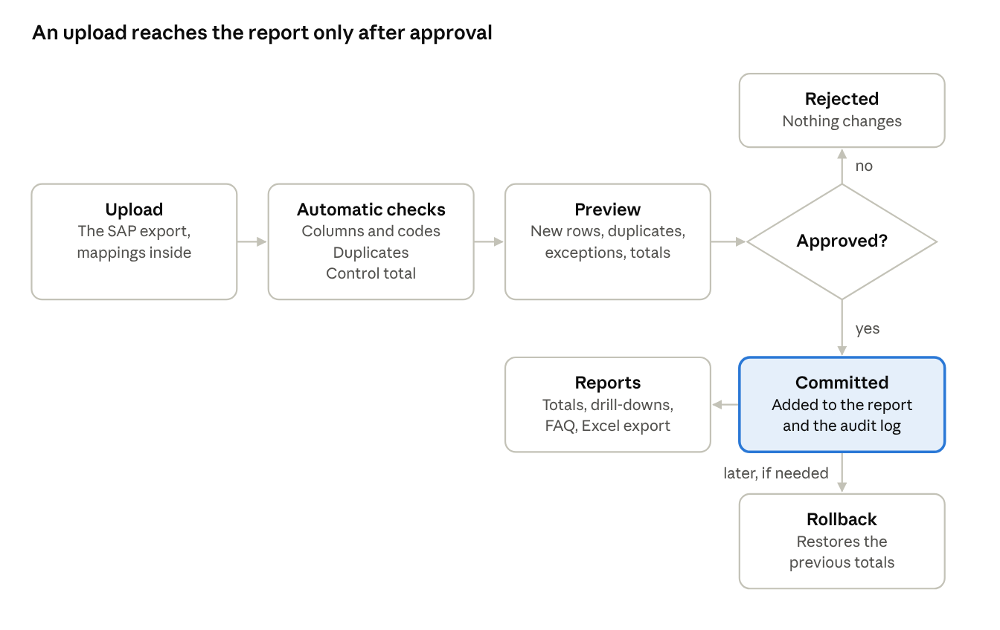
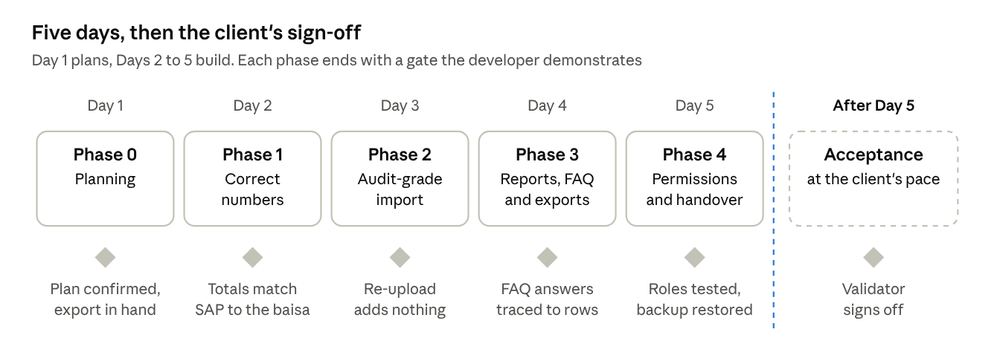

# IDS Spend Audit Delivery Plan

## Summary

IDS Spend Audit is a small application. It shows how much IDS has actually spent against each GL account, which budget line the money came from, and which cost center and IDS department spent it.

Users upload the SAP export. The app checks it, shows a preview, and adds it to the report only once an approver accepts it. Every figure can be traced back to the row in the file it came from.

The plan takes **five working days** with one developer: Day 1 for planning, and Days 2 to 5 for the build. The client's review and sign-off follow the build. For now, the application runs locally on the developer's machine.

**Current status:** the client has approved this plan. The real SAP export hasn't arrived yet, so the build starts on a sample file made to look like a real SAP export (see Phase 1).

## Goal and scope

The goal is an auditable view of cumulative IDS actual spend by GL account, shown as numbers and charts. Every number must trace back to its source row.

**Questions the app answers**

1. How much has IDS spent in total?
2. Which GL accounts has IDS spent the most on?
3. Which budget line does each GL account belong to?
4. Which cost centers and departments used a GL account?
5. How much has each department spent?
6. What has a department spent its money on?
7. How has spending built up over time?
8. What couldn't be matched to a budget line or an IDS department?

**In scope**

- Uploading the SAP export: an Excel file with the GL and cost center mapping sheets inside it, or a CSV of spend lines only, which uses the mappings the report already has.
- Several report instances. Each upload adds to an existing report, or starts a new one if the user is allowed to create reports.
- Automatic checks: column detection, code matching, duplicate detection, and reconciliation against the file's control total.
- Preview before approval, plus rollback of approved uploads, newest first. To undo an older upload, the newer ones are rolled back before it, and their files can then be uploaded again.
- Reports: totals, GL drill-down to the source rows, department and budget-line views, exceptions, FAQ pages and charts.
- Cost centers outside IDS flagged, with an option to exclude them.
- Excel export, with a sheet recording where the figures came from.
- An audit log of every sign-in, upload, approval, rollback, export and access change.
- User accounts with per-report access, managed by administrators.
- Packaged to run on one machine with a single command, with backup and restore.
- OQGN's theme: every screen in OQGN's colours, with its logo, as the client asked.

## Users, sign-in and access

Every user signs in with their own account. An administrator decides which reports each user can use, and what they can do in each one.

**Sign-in**

- Each person has their own account. There are no shared accounts and no self-registration: only an administrator creates accounts.
- Users sign in with a username and password. Passwords are stored hashed, never as plain text, and must be at least 12 characters long.
- A new user gets a temporary password from an administrator, and must change it at the first sign-in.
- A user who forgets their password asks an administrator to reset it, then chooses a new one at the next sign-in.
- After 5 failed attempts, the account is locked for 15 minutes.
- A session ends after 30 minutes without activity, or when the user signs out.
- An administrator can disable an account. Its history stays in the audit log.
- Sign-ins, failed sign-ins, and every change to accounts or access are recorded in the audit log.

**Administrators**

Administrators are fixed accounts, created from the command line. Each one starts with an initial password and must change it at the first sign-in. They can't be deleted, and their rights can't be reduced from inside the application.

Administrators create users and roles and grant report access. They can see every report and the full audit log. They also hold every permission on every report, so they can approve a file they uploaded themselves. The audit log shows who uploaded and who approved each file.

**Permissions**

Each permission applies to one report at a time.

| Permission | Allows, on that report |
| --- | --- |
| View | See the report's screens and FAQ pages |
| Export | Download Excel exports |
| Upload | Upload a file, see its preview, and withdraw it before approval |
| Approve | Approve or reject an upload |
| Roll back | Roll back an approved upload |
| View audit log | See who did what, and when |

**Roles and report access**

A role is a named set of permissions. Administrators create, change and remove roles, and three come preset:

| Role | Permissions |
| --- | --- |
| Viewer | View, Export |
| Uploader | View, Export, Upload |
| Approver | View, Export, Approve, Roll back, View audit log |

The administrator gives each user a role on each report they may use. A user sees only those reports, and can hold different roles on different reports, such as Uploader on one and Viewer on another.

Creating a new report isn't one of these permissions. By default only administrators create reports, and the open questions settle whether others can.

The application checks the user's permission on that report for every action. Hiding a button is never the only protection.

In practice, the person who uploads a file doesn't approve it, so the preset roles keep Upload and Approve apart. The administrator can still put both permissions in one role when needed.

## How it works and principles

An upload changes the report only after the file passes the automatic checks and an approver accepts the preview. A rejected file changes nothing, and an approved one can be rolled back later.

A rollback is also recorded in the audit log, so the report's history stays complete.

**Principles**

1. **Traceable:** every number on screen or in an export traces back to a file, sheet and row.
2. **Exact:** amounts are stored and added as exact decimals, so totals match SAP to the baisa.
3. **Preview first:** nothing enters a report without a preview and an approval.
4. **Self-contained:** the application runs on one machine and sends nothing to outside services.
5. **Proven technology:** widely used open-source components, with nothing exotic to maintain.

## Phases

Day 1 is planning. The build runs from Day 2 to Day 5 with one developer, and each phase ends with a gate the developer demonstrates. The client's sign-off follows the build.

The dashed line marks the end of Day 5. After it, timing depends on the client's review.

### Phase 0: Planning (Day 1)

- **Goal:** agree this plan with the client.
- **Deliverables:** this plan, confirmed.
- **From the client:** confirmation of the plan. The real SAP export, with SAP's own totals for it, can follow during the build.
- **Done when:** the client confirms the plan.

### Phase 1: Correct numbers (Day 2)

- **Goal:** prove the app calculates exactly what SAP reports.
- **Deliverables:**
  - database tables for reports, uploads, postings and the two mappings
  - a sample file that imitates an SAP G/L line item export (transaction FAGLL03), with the GL and cost center mapping sheets and its expected totals
  - reading the export: finding its sheets, header rows and columns, first in the sample file and then in the real export
  - cleaning rules: codes without leading zeros, SAP amounts such as `1,234.500-`, and dates as dd.mm.yyyy
  - counting only actual spend, using the export's value type where it has one
  - joining each posting to its budget line, its cost center and its IDS department
  - automated tests that check the totals for the sample file, and for the real export once it arrives
- **From the client:** the real export, plus SAP's own totals for it: the overall total and at least three GL accounts. The build doesn't wait for it, but acceptance does.
- **Done when:** the app's totals for the sample file match its expected totals to the baisa, and the automated tests pass. Once the real export arrives, its overall total and those three GL totals must also match SAP's to the baisa.

### Phase 2: Audit-grade import (Day 3)

- **Goal:** nothing enters a report unchecked, and nothing is counted twice.
- **Deliverables:**
  - sign-in for the fixed administrator accounts, so every action is recorded against a named user from the start
  - the upload screen, and a preview showing rows read, rows skipped, new rows, duplicates, exceptions and the control-total result
  - approve and reject
  - duplicate detection: by default, by replacing the period the file covers. On the report's first upload, the approver can choose detection by line item instead. It's offered only if every spend line carries its company code, fiscal year, document number and line item
  - control-total reconciliation that blocks approval when it doesn't match
  - rollback of an approved upload
  - the audit log of uploads, approvals, rejections and rollbacks
  - several reports, with each upload starting a new report or adding to an existing one
- **From the client:** the answers marked Day 3 in Open questions, especially how exports are produced and whether every spend line can carry the four fields listed above.
- **Done when:**
  1. Uploading the same file twice leaves the totals unchanged.
  2. A file whose control total doesn't match can't be approved.
  3. Rolling back an upload restores the earlier totals exactly.
  4. Every one of these actions appears in the audit log, with the user who did it.

### Phase 3: Reports (Day 4)

- **Goal:** answer the audit questions on screen and in Excel.
- **Deliverables:**
  - the overview: total actual spend, a bar chart by GL account, and the running total by month
  - the GL accounts view: each account with its budget line, cost centers and departments, and drill-down to the source rows
  - department and budget-line views
  - exceptions: GL accounts with no budget line, cost centers outside IDS, and budget-line changes between files
  - filters for year and for excluding cost centers outside IDS
  - FAQ pages, one for each of the eight questions in Goal and scope, which came from the client. More are added in code when the client needs them. The client confirmed that a fixed FAQ is enough, so users don't add questions in the app
  - Excel export of any view, with a source sheet listing the filters and uploads it used. Each export is recorded in the audit log
- **Done when:** every FAQ answer for the sample file, and for the real export once it arrives, is on screen, each total equals the sum of its source rows, and the Excel export matches the screen.

### Phase 4: Permissions and handover (Day 5)

- **Goal:** control who can do what, and hand over a working application.
- **Deliverables:**
  - user accounts created by administrators, with password reset by an administrator
  - the password, lock-out and session rules from "Users, sign-in and access"
  - roles that administrators create, with Viewer, Uploader and Approver preset
  - per-report access: a role for each user on each report
  - the audit log screen, including sign-ins and access changes
  - the application packaged with Docker, starting on the developer's machine with one command
  - backup and restore of the database and the uploaded files
  - a short guide for users and administrators
  - OQGN's theme on every screen: its colours and logo, applied once the screens are complete
  - a demo to the client
- **From the client:** the first users, the reports each one can use, and their role on each. OQGN's colours and logo, for the theme.
- **Done when:**
  1. Automated tests show each user sees only their reports, and can do only what their role allows on each.
  2. A locked or disabled account can't sign in.
  3. A backup restores with the totals unchanged.
  4. The client has seen the demo.

### Acceptance (after Day 5, at the client's pace)

- **Goal:** the client confirms the figures are right.
- **Steps:**
  1. The client reviews the application with the developer, using real exports.
  2. The validator compares every FAQ answer with SAP.
  3. The developer fixes anything that doesn't match.
  4. The validator signs off.
- **Done when:** the validator has signed off.

## Open questions

Each answer is needed by the day shown, or that phase uses the default.

| Question | Needed by | Default if unanswered |
| --- | --- | --- |
| The real SAP export, with SAP's own totals for it | Before acceptance | The build uses the sample file. Acceptance can't start without the real export |
| Which SAP report produces the export? | Before acceptance | G/L line items (FAGLL03), the layout the sample file imitates |
| Does the export hold only actual spend, or also POs and PRs? If both, which column marks actual spend, and which of its values are actual spend and which aren't? | Day 2 | Every row is treated as actual spend |
| Is the company code's local currency Omani rials, and which export columns hold the local amount and its currency? | Day 2 | Yes, in the columns the sample file uses: `Amount in LC` and `LCurr` |
| Is every cost center that isn't in the cost center mapping outside IDS? | Day 2 | Yes |
| Is each export the new month only, or year-to-date each time? | Day 3 | Replace the period the file covers |
| Can every spend line in the export include its company code, fiscal year, document number and line item? | Day 3 | Replace the period the file covers |
| Does the export include a control total? | Day 3 | The uploader enters SAP's total for the file before approval |
| If a GL account's budget line changes between files, which applies: the latest file, the posting's own file, or the one for its fiscal year? | Day 3 | The latest file, with the change flagged as an exception |
| How many rows per file, and how many files per month? | Day 3 | Imports run while the user waits, which suits files up to tens of thousands of rows |
| Who can create a new report, and what access does its creator get? | Day 3 | Administrators only |
| The first users, the reports each one can use, and their role on each | Day 5 | One demo account per preset role, used only for the demo and disabled before real use |
| OQGN's colours and logo, for the theme | Day 5 | The screens keep their plain look until they arrive |
| Who validates the numbers? | Before acceptance | Acceptance can't start |
| Where the application runs after sign-off | After sign-off | The developer's machine |

## Glossary

| Term | Meaning |
| --- | --- |
| GL account | The General Ledger category that says what was bought, such as software licenses |
| Commitment item | The budget line that pays for the spend, in SAP Funds Management. Several GL accounts usually share one |
| Cost center | The code for the team that spent the money |
| Department | The IDS department a cost center belongs to, taken from the mapping sheet |
| Outside IDS | A cost center that isn't in the IDS cost center mapping |
| Actual spend | Posted invoices. Only this counts as spend in the app |
| PR / PO | Purchase requisition (an internal request) and purchase order (the order sent to the supplier). Neither counts as spend |
| Control total | The total printed in the export, used to check that every row was read |
| Reconciliation | Checking that imported plus skipped amounts equal the control total |
| Rollback | Removing an approved upload's effect on a report, recorded in the audit log |
| Report | A separate set of uploads, with its own totals and its own user access |
| Role | A named set of permissions that an administrator gives a user on a report |
| Validator | The client's finance person who checks the app's figures against SAP and signs off |

## Engineering documents

Each engineering document begins with the phases of this plan that it implements, and links back here.

| Document | Covers | Main readers | Phases |
| --- | --- | --- | --- |
| ENG-01 Architecture, security and operations | Components, technology choices, running the application, permissions and roles, backup and restore | Developers, maintainers | 1, 2, 4 |
| ENG-02 Data model and import | Tables, mapping versions, file reading, cleaning rules, upload states, duplicates, reconciliation, rollback | Finance validator, developers | 1, 2 |
| ENG-03 Reports, FAQ and exports | What each screen shows, the query behind each FAQ answer, the Excel export format | Users, finance validator | 3 |
