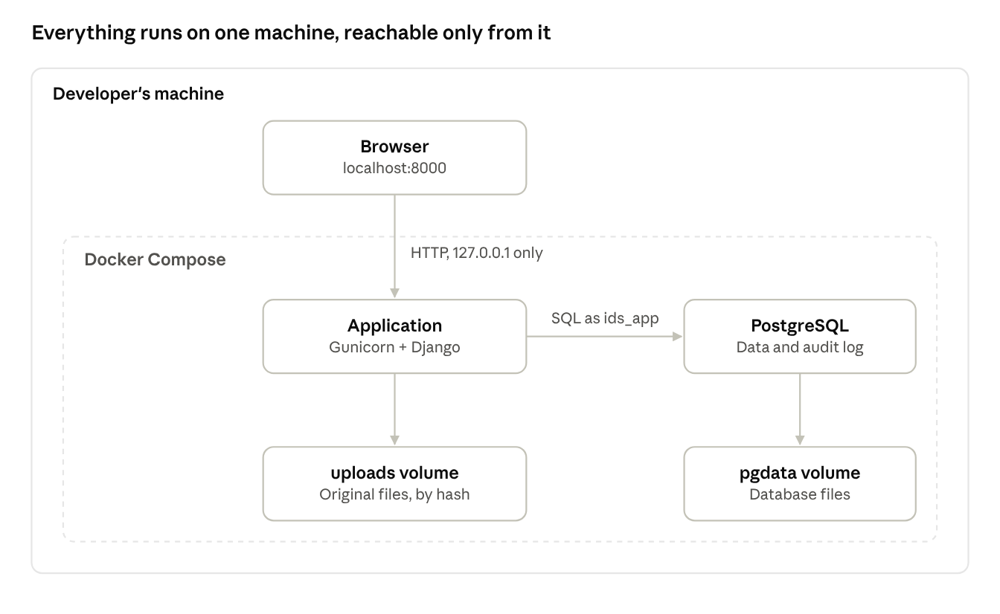

# ENG-01 Architecture, Security and Operations

Implements: Phases 1, 2 and 4 of [IDS Spend Audit Delivery Plan](../IDS%20Spend%20Audit%20Delivery%20Plan.md).

## 1. Purpose and scope

This document describes how IDS Spend Audit is built, secured and run on the developer's machine. It covers the components, technology choices, code structure, request flow, security and operations.

The delivery plan stays the single source of decisions. Where a section implements one of the plan's rules, it names that rule instead of repeating it.

Two things are covered elsewhere:

- **ENG-02 Data model and import:** the tables, file reading, cleaning rules, duplicates, reconciliation and rollback.
- **ENG-03 Reports, FAQ and exports:** what each screen shows, the queries behind the FAQ answers, and the Excel export format.

## 2. System overview

The whole system runs on the developer's machine as two containers, the application and the database, started together by Docker Compose. Users open it in a browser on the same machine. Inside its container the application listens on port 8000, and Docker publishes that port on the machine's 127.0.0.1 only, so other machines can't reach it. Docker publishes the database's port on 127.0.0.1 only as well, so the developer's tests and `manage.py` can reach it from the same machine (7.5).



The browser reaches the application only through 127.0.0.1. The application is the only component that talks to the database and the file store.

| Component | Job | Runs as |
| --- | --- | --- |
| Browser | Shows the pages. HTMX swaps parts of a page in place, and ECharts draws the charts | The user's browser at `http://localhost:8000` |
| Application | Django, served by Gunicorn. Handles sign-in, uploads, checks, preview, approval, reports and exports | The `app` container |
| Database | PostgreSQL. Holds reports, uploads, postings, mappings, users, roles, report access and the audit log | The `db` container, with its data in the `pgdata` volume |
| File store | Every uploaded file, saved unchanged under its SHA-256 hash | The `uploads` volume, mounted into the `app` container |
| Migration job | Applies database changes using the owner role, then exits | A one-off `migrate` container that runs before `app` starts |

## 3. Technology choices

Every choice favours exact arithmetic, few moving parts and long support. Exact versions of every library are pinned in `uv.lock`. JavaScript libraries are copied into the repository instead of loaded from the internet.

| Layer | Choice | Version | Why | Considered instead |
| --- | --- | --- | --- | --- |
| Language | Python | 3.12 | Mature Excel libraries, and exact decimal arithmetic built in | Node.js: no built-in decimal type, so amounts risk float errors |
| Web framework | Django | 5.2 LTS | Built-in sign-in, forms and migrations, with security fixes until April 2028 | FastAPI: sign-in, admin and migrations would have to be assembled |
| Application server | Gunicorn | Pinned | Runs several Django processes and replaces any that crash | Django's development server, which isn't meant for real use |
| Static files | WhiteNoise | Pinned | Serves CSS and JavaScript from Django, with no separate web server | Nginx, which is added only with a final host |
| Database | PostgreSQL | 17 | Exact `NUMERIC` amounts, transactions, views, `COPY` for bulk loading, and role permissions | SQLite: weak with concurrent writes, and no role permissions |
| Database driver | psycopg | 3 | Supports `COPY` from Python | psycopg2, the older driver |
| Page updates | HTMX | 2, in the repository | The server renders HTML and HTMX swaps parts of the page, so there is no second front-end codebase | React, which needs a separate app and an API |
| Small behaviours | Alpine.js | 3, in the repository | Dropdowns and "click again to confirm" without custom JavaScript | Plain JavaScript |
| Charts | Apache ECharts | Pinned, in the repository | Fast with long series, with built-in tooltips | Chart.js, which is weaker with large data |
| Excel reading | python-calamine, with openpyxl as a fallback | Pinned | calamine is fast. openpyxl handles unusual files | pandas, which turns amounts into floats by default |
| Excel writing | XlsxWriter | Pinned | Cell formats, frozen headers, and a memory-saving mode for large exports | openpyxl, which is slower for large exports |
| Sign-in lock-out | django-axes | Pinned | Counts failed sign-ins and locks accounts, configured by settings | A hand-written counter |
| Password hashing | Argon2, through argon2-cffi | Pinned | Django's recommended hasher | PBKDF2, Django's default |
| Settings file | python-dotenv | Pinned | Django reads `.env` itself when it runs outside Docker, so `manage.py`, pytest and the editor's test button all see the same settings (7.5) | uv's `--env-file` option, which every command would have to repeat, and which stops with an error when `.env` is missing |
| Packaging | Docker Compose | Current | One command starts the application and database the same way on any machine | Installing Python and PostgreSQL by hand |
| Development tools | uv, ruff, pytest, pytest-django, Hypothesis, Playwright, time-machine | Pinned | Locked dependencies, linting, and unit, property and browser tests. time-machine moves the clock for the tests of lock-outs, idle sessions and interrupted reads, for Django and django-axes alike, so no test waits | freezegun, which is slower because it patches every loaded module. Mocking `timezone.now`, which misses code that reads the clock another way |

**Optional components.** Each is added only when its trigger happens.

| Component | Added when | Tied to |
| --- | --- | --- |
| Background worker (Procrastinate, which uses PostgreSQL as its queue) | Files are large enough that users would wait too long during import | The plan's open question on rows per file |
| Nginx with HTTPS | The application moves off the developer's machine | The plan's open question on where it runs after sign-off |

## 4. Code structure

The repository is `IDS-Audit`, and the application code lives in the Python package `ids_audit`. Python names can't contain hyphens.

```text
IDS-Audit/
├── config/            Django settings (base, dev, test, production, migrate), URLs, WSGI entry point, Gunicorn's settings
├── ids_audit/
│   ├── pipeline/      plain Python: reading files, cleaning rows, reconciliation, duplicate rules
│   ├── accounts/      users, roles, report access, sign-in rules, the access check
│   ├── imports/       uploads, file storage, staging, preview, approve, reject, rollback
│   ├── ledger/        postings, mapping versions, the resolved view
│   ├── reports/       reports, report screens, FAQ queries, chart data, Excel exports
│   ├── audit/         the append-only audit log
│   ├── templates/     pages and the partial templates HTMX swaps in
│   └── static/        CSS, OQGN's logo, and the HTMX, Alpine.js and ECharts files
├── sql/               database roles and grants
├── tests/             unit, golden-file, permission and browser tests
│   └── fixtures/      the generated sample files, their script and expected results (ENG-02, 12.3)
├── scripts/           backup.sh and restore.sh
├── docs/              the plan, engineering/, CONTRIBUTING.md, and the guide for users and administrators
├── backups/           backups made by scripts/backup.sh (7.2). Git ignores everything here except its README
├── real-export/       the client's real SAP export and SAP's totals for it (ENG-02, 12.2). Git ignores everything here except its README
├── Dockerfile
├── compose.yaml
├── .env               the real settings and passwords (7.1). Git ignores it
└── .env.example       every setting the application needs, with no real values
```

**Boundary rules**

1. **`pipeline/` imports nothing from Django.** It takes rows in and returns clean rows, skipped rows and check results. The riskiest logic is tested without a database.
2. **Only `imports/` writes postings,** and only inside the single transaction that runs at approval (see 5.1).
3. **Every view that touches a report calls the one access check in `accounts/`** (see 6.2). No view decides access on its own.
4. **`audit/` exposes one function, `record()`,** which every other part calls. Nothing else writes to the audit log.
5. **Amounts are `Decimal` in Python and `NUMERIC(18,3)` in PostgreSQL.** They never pass through a float. The one exception is `skipped_row.amount`, which is plain `NUMERIC`. `NUMERIC(18,3)` would silently round an amount skipped for having more than 3 decimal places, such as `12.3456` to `12.346`, so the skipped row keeps it exactly as read (ENG-02, 5).

**Build order**

The plan's Phase 1 gate compares the application's totals with expected totals. A posting counts only once it's committed (ENG-02, 10.2), and every figure comes from `reports/queries.py` (ENG-03, 2). So Phase 1 builds every step a figure passes through, in its plain form, called from the tests. A test that added up cleaned rows straight from `pipeline/` would skip staging, commit, the view and the queries, which are the steps the real figures take.

| Step | Phase 1 builds | Added later |
| --- | --- | --- |
| Receive | Creating a report with ruleset version 1. Hashing and storing a file, and creating its upload at `reading` (5.1) | Phase 2: the upload screen, the screen for creating a report, the refusals before an upload exists, and one open upload per report (ENG-02, 6) |
| Read and clean | `pipeline/`: reading (ENG-02, 4), cleaning (ENG-02, 5) and the actual-spend rule (ENG-02, 3) | Phase 2: picking columns at `needs_columns` |
| Stage | Staging rows, skipped rows and mapping rows. The upload's column layout, period, control total from the file, row figures with their amounts, and difference (ENG-02, 9 and 11.1) | Phase 2: the refusals before an upload exists (ENG-02, 6 and 7.1), line-key duplicates (ENG-02, 7.3), the entered control total (ENG-02, 9.1), reconciliation that blocks approval (ENG-02, 9.3), and the rest of the preview and its screen (ENG-02, 11) |
| Commit | ENG-02, 10.1, writing its audit event through `audit.record()`, except the checks that need Phase 2: the user's access, what blocks approval, and whether the preview is still current. A report's first commit sets replace by period | Phase 2: sign-in, the rest of 10.1's checks, choosing line-key mode when approving the first upload, the approve and reject screens, and rollback. Phase 4: roles and per-report access |
| Resolve | `posting_resolved` in full (ENG-02, 8.4) | Nothing |
| Add up | In `reports/queries.py`: the total, inside and outside IDS, and the totals by GL account, budget line, department and month (ENG-03, 2.3). `manage.py report_totals` | Phase 3: filters, screens, drill-down, the FAQ and exports |

- **The access check exists from Phase 2,** when sign-in and the first screens arrive. Phase 1's steps are called only from the tests, with no user signed in. Until Phase 4 added roles, fixed administrators were the only users who could do anything: they pass every check (6.2, rule 4). Phase 4 changed only the check's answer to which permissions a user holds (6.2).
- **The Phase 1 gate test** sends the sample file through every step and compares every figure with its expected result. It then does the same with the semicolon file uploaded after it (ENG-02, 12.2). The real export follows the same path once it arrives. It compares every figure the steps above build: the header row, the row figures, the period, the reconciliation, the actual spend and its groups, `report_totals`, the skipped rows, and the postings replaced. From Phase 2 it also compares the preview's other rows and its exception lists by code (ENG-02, 11.2), which `posting_resolved`'s tests check as well (ENG-02, 8.4).

**Tested by:** the Phase 1 gate test reaches the figures only through the `imports/` functions and `reports/queries.py`, never by calling `pipeline/` directly.

## 5. How requests flow

### 5.1 An upload, from file to committed rows

1. The browser sends the file to `imports/`. Django checks that the user has Upload on the chosen report, that the file is within the size limit, and that its first bytes match an accepted format (see 6.4).
2. Any interrupted read in the report is marked `failed` (ENG-02, 6). The application then computes the file's SHA-256 hash, and one transaction:
   1. locks the report's row, so a second file for the same report waits until this one is received or refused
   2. refuses the file if its hash matches a committed upload in the same report (ENG-02, 7.1), or if the report has an open upload (ENG-02, 6). Nothing is stored and no upload is created
   3. saves the file under its hash, in the folder `UPLOADS_DIR` names (7.5). It writes the file under a temporary name and then renames it, so a file under a hash name is always complete
   4. gives the upload the report's next number (ENG-02, 2), creates it at `reading` and writes `upload_received`. The lock means two uploads never read the same highest number

   A refused file writes `upload_refused` once the transaction is undone (6.3), so the attempt stays on record. If the transaction fails after the file is saved, the stored file stays. Another upload may share it, since the same bytes always have the same name, and a new try writes the same bytes again.
3. `pipeline/` reads the sheets, finds the header rows and columns, and cleans every row. It returns clean rows, skipped rows with their reasons, and the file's mapping sheets. If a required column isn't found, the upload stops at `needs_columns` until the uploader picks it. If the file can't be read, it ends at `failed` (ENG-02, 6).
4. In one transaction, the clean rows are bulk-loaded with `COPY` into a staging table, and the skipped rows and the file's mapping rows are saved, all tagged with the upload's ID. Reconciliation is worked out from the rows read, the same rows that are staged (ENG-02, 9), duplicate detection runs against the postings already in the report (ENG-02, 7.3), and the upload moves to `awaiting_approval`.
5. The preview shows rows read, rows skipped, new rows, duplicates, exceptions and the reconciliation result. ENG-02 defines each figure.
6. A user with Approve on the report approves. One database transaction then:
   1. copies the staging rows not marked `is_duplicate` into postings
   2. checks their count and total against the preview
   3. marks the upload `committed`
   4. writes the audit event

   ENG-02, 10.1, gives every step. If any step fails, the whole transaction is undone and the report doesn't change.
7. If the user rejects instead, the upload becomes `rejected`, its staging rows are deleted, and the audit log records the rejection. The original file stays in the file store.

Steps 3 and 4 run inside the web request. If files turn out to be too large for that, they move to the background worker and the page checks the upload's status every few seconds (see Section 8).

**Tested by**

- The stored file is byte-identical to the file received, and its name and `upload.file_sha256` are the SHA-256 of its bytes.
- A failure inside step 2's transaction leaves no upload and no event, and the stored file stays.

### 5.2 A report view, from filter click to page

1. The user changes a filter. HTMX sends a request with the filters in the address, for example `/reports/7/overview?year=2026&exclude_outside=1`.
2. Django checks that the user has View on report 7.
3. It runs aggregate SQL over that report's resolved view (ENG-02), with those filters. PostgreSQL adds the amounts as exact decimals.
4. Django renders only the changed panel, which holds everything the filters change, its Export link included (ENG-03, 4). HTMX swaps it into the page and updates the address, so the view can be bookmarked or shared.
5. Chart figures arrive inside the panel as data, and ECharts draws them. The browser never calculates a figure.

## 6. Security

### 6.1 Authentication

**Implements:** the plan's "Users, sign-in and access", the Sign-in and Administrators parts.

The application uses a custom user model from its first migration, as Django recommends. It keeps Django's standard fields, except that one required `full_name` replaces `first_name` and `last_name`. It adds two flags: `is_fixed_admin` and `must_change_password`.

**Names.** `full_name` holds the name as the person writes it, in Arabic or English. An Omani name such as "Mohammed bin Said bin Ali Al Balushi" doesn't split into a first and a last name. Two people can share a full name, but never a username. So wherever the application names a user, as in the as-of line and the export's Source sheet (ENG-03, 3.2 and 9.2) and the audit log, it shows "Full name (username)".

| Rule in the plan | How it is implemented |
| --- | --- |
| Own accounts, created only by administrators | There is no sign-up page. Fixed administrators create accounts in the administration screens at `/admin/` (below) |
| Username and password, stored hashed | Django sign-in, with Argon2 as the first entry in `PASSWORD_HASHERS` |
| Passwords of at least 12 characters | Django's password validators: minimum length 12, plus the common-password, all-numeric and similar-to-username checks. The last compares the password with the username, the full name and the email |
| New users change their temporary password at first sign-in | Creating a user requires a temporary password and turns on `must_change_password`. Until the user changes it, every page redirects to the change-password page, which asks for the temporary password and the new one twice. The new password can't be the one it replaces, so whoever set a temporary password never knows the password in use. Changing it turns `must_change_password` off and writes `password_changed` |
| Reset by an administrator, with a new password chosen at next sign-in | A reset, from the user's page in the administration screens, sets a new temporary password and turns `must_change_password` on again. A fixed administrator's password is reset only from the command line (below) |
| Locked for 15 minutes after 5 failed attempts | django-axes, with `AXES_FAILURE_LIMIT = LOCKOUT_ATTEMPTS`, `AXES_COOLOFF_TIME = timedelta(minutes=LOCKOUT_MINUTES)`, `AXES_LOCKOUT_PARAMETERS = ["username"]` and `AXES_RESET_ON_SUCCESS = True` and `AXES_RESET_COOL_OFF_ON_FAILURE_DURING_LOCKOUT = False`. None of these is django-axes' default. Lock-out is by username because every user signs in from the same machine, so a lock-out by address would lock everyone. A successful sign-in resets the count. The lock lasts 15 minutes from the failure that started it, as the plan says, however often someone tries meanwhile: django-axes' default would start the 15 minutes again at every try. While it lasts, the sign-in page says the account is locked and for how long |
| Session ends after 30 minutes without activity, or at sign-out | `SESSION_COOKIE_AGE = SESSION_IDLE_MINUTES * 60`, and `SESSION_SAVE_EVERY_REQUEST = True`, so each request restarts the 30 minutes. Session cookies are HttpOnly and SameSite=Lax |
| Disabling keeps the history | Disabling sets `is_active = False`, and a session the account still has ends at its next request. Users are never deleted, so their audit history stays linked: no screen deletes one, and `ids_app` has no `DELETE` on the user table, so the database refuses it from any other path too (6.3) |
| Sign-ins and failures are logged | Django's `user_logged_in`, `user_logged_out` and `user_login_failed` signals write `sign_in`, `sign_out` and `sign_in_failed`. django-axes' `user_locked_out` signal writes `account_locked`, once, for the failure that locks the account (6.3). A session that times out writes nothing, since nothing signals it, so `sign_out` always means the user signed out |

**Every page needs sign-in.** Every address except the sign-in page needs a signed-in user, through Django's `LoginRequiredMiddleware`, so every action is recorded against a named user from Phase 2 (the plan, Phase 2). Anyone else is sent to the sign-in page, and back to the page they asked for once signed in.

**Redirects in HTMX requests.** A panel request that has to go to the sign-in page, after a time-out, or to the change-password page gets an `HX-Redirect` header instead of a redirect. HTMX then moves the whole page, so neither page lands inside a panel.

**The administration screens**

The administration screens are the application's own pages under `/admin/`. They extend the base template and take OQGN's theme like every other screen (ENG-03, 4). Only an active fixed administrator can open them, and anyone else gets 403.

Django's own admin, `django.contrib.admin`, isn't installed. It saves through its own forms and actions: its "delete selected" deletes a whole queryset without calling the model's `delete()`, so it passes the guard on fixed administrators. It records changes only in its own `django_admin_log` table, offers `is_staff`, `is_superuser` and Django's table-wide permissions, which the application doesn't use, and has its own look. Each path would have to be overridden, and one missed would change an account with no event. On the application's own pages, every form calls one function in `accounts/services.py` or `accounts/roles.py`, which checks again that its caller is an active fixed administrator and writes its event in the same transaction (6.3).

| Address | Shows or does |
| --- | --- |
| `/admin/` | Links to Users, Roles and the audit log |
| `/admin/users` | Every account: its username and full name, whether it's a fixed administrator, disabled, locked out or waiting for its first password, and how many reports it has a role on |
| `/admin/users/new` | Creates an account: username, full name, email if any, and a temporary password twice. Writes `user_created` |
| `/admin/users/<id>` | One account. Its full name and email, which can be corrected (`user_changed`). Reset password, with a new temporary password twice (`password_reset`). Disable (`user_disabled`) or Enable (`user_changed`). Unlock, while it's locked out (`account_unlocked`). And every report, each with the user's role on it or No access, which gives, changes or takes away their role there (`access_granted`, `access_changed`, `access_removed`) |
| `/admin/roles` | Every role, with its permissions and how many times it's given |
| `/admin/roles/new` and `/admin/roles/<id>` | Creates or changes a role: its name and permissions (`role_created`, `role_changed`). Remove, refused while the role is given to anyone (`role_removed`) |
| `/admin/audit` | The whole audit log (ENG-03, 4) |

- **Usernames don't change.** Events keep the username they concern, so renaming an account would split its history.
- **A fixed administrator's page only shows the account.** It's changed only from the command line, so the page has no form for it, and the functions refuse it too.
- **Only these fields.** The forms never offer `is_fixed_admin`, `is_staff`, `is_superuser`, `can_create_reports` (8), or Django's groups and permissions.
- **Actions are forms sent with POST,** as on the upload screens (ENG-03, 4), each to its page's address plus its name: `details`, `password`, `disable`, `enable`, `unlock` and `access` under `/admin/users/<id>/`, and `remove` under `/admin/roles/<id>/`. A role's own address saves its form. A refused action changes nothing, and the page says why.
- **`createsuperuser` is replaced** by a project command of the same name that creates nothing and names `create_admin`. Django's would make an account that's neither a fixed administrator nor in the audit log.

**Fixed administrator accounts**

- **Created from the command line:** `manage.py create_admin <username>` asks for the full name, then twice for an initial password, without showing it, and checks it against the 12-character rule. It creates the account as a fixed administrator with `must_change_password` on, so the administrator chooses their own password at first sign-in. The audit log records the creation as a command-line action, `user_created` (6.3).
- **No passwords in files:** no administrator username or password is kept in `.env`, or anywhere else outside the database.
- **Removing one:** `manage.py disable_admin <username>` disables the account and writes `user_disabled`. Its history stays in the audit log.
- **Checking who they are:** `manage.py list_admins` shows every fixed administrator, with their full name, and whether the account is active.
- **No changes from inside the application:** it refuses to delete, disable or remove rights from a fixed administrator, both in the screens and in the model's save and delete logic. `disable_admin` is the only way to disable one.
- **Recovery:** a fixed administrator's forgotten password is reset only from the command line, with `manage.py changepassword <username>`. A locked administrator is unlocked with `manage.py axes_reset_username <username>`. The project replaces both commands with its own, under the same names, so each writes its event: `changepassword` is a reset, so it also turns `must_change_password` on and writes `password_reset`, and `axes_reset_username` writes `account_unlocked`. Django's and django-axes' own versions write nothing to the audit log.
- **Who can run these commands:** only someone with shell access to the developer's machine. That's the same boundary that protects `.env` and the database.

**Tested by**

- Five wrong passwords lock the account. With the clock moved forward 15 minutes, it signs in again.
- Five wrong passwords write five `sign_in_failed` events and one `account_locked`. A sixth try during the lock is refused, writes a `sign_in_failed` but no second `account_locked`, and doesn't move the end of the lock.
- Four wrong passwords, a right one, then four more wrong ones don't lock the account.
- Five wrong passwords for one username don't stop another user signing in.
- With the clock moved forward 31 minutes of inactivity, the user is signed out, and an HTMX request gets an `HX-Redirect` to the sign-in page.
- An 11-character password is refused, including by `create_admin`.
- A new user, and a user whose password was reset, can't reach any page except the change-password page until they change it. An HTMX request from them gets an `HX-Redirect` to the change-password page.
- `create_admin` creates a fixed administrator who must change the initial password at first sign-in, and refuses a username that already exists or an empty full name.
- A user is shown as "Full name (username)" in the as-of line, the Source sheet and the audit log.
- After `disable_admin`, that administrator can't sign in, and `list_admins` shows the account as disabled.
- A fixed administrator can't be deleted or disabled from inside the application.
- Every address but the sign-in page sends a user who isn't signed in to the sign-in page, and back once they sign in.
- `changepassword` turns `must_change_password` on, and `axes_reset_username` lets a locked account sign in at once, each writing its event.
- Only an active fixed administrator opens any address under `/admin/`. Anyone else gets 403.
- A fixed administrator creates a user, who must then change the temporary password at first sign-in, corrects their full name, resets their password, disables and enables the account, unlocks it, and gives, changes and takes away their role on a report, each from its page. Each writes its one event, with the `details` 6.3 gives.
- A disabled user can't sign in, and one still signed in when their account is disabled is signed out at their next request.
- A fixed administrator's page has no form, and each function refuses to change a fixed administrator.
- Entering the temporary password again as the new one is refused, and `must_change_password` stays on.
- `createsuperuser` creates no account.

### 6.2 Authorization

**Implements:** the plan's "Users, sign-in and access", the Permissions and Roles and report access parts.

The six permissions are fixed in code: `view`, `export`, `upload`, `approve`, `roll_back` and `view_audit_log`. Each one applies to a single report. Django's built-in permissions apply to a whole table, not one report, so they aren't used for this.

| Table | Holds | Rules |
| --- | --- | --- |
| `Role`, in table `role` | A name, and its permissions as a list of the six names | Viewer, Uploader and Approver are created by a data migration, with the plan's permissions. Administrators can edit them like any other role. A role still assigned to anyone can't be removed. Two roles can't share a name, even in different capitals. Every role holds **view**, which every report address needs, so a role always gives more than no access (rule 2). The database checks both rules about permissions: each one named is one of the six, and **view** is among them |
| `ReportAccess`, in table `report_access` | A user, a report and a role | At most one row per user and report. No row means no access. A fixed administrator has no rows, since they already hold every permission (rule 4) |
| `User.can_create_reports` | An account-level flag | Off by default. Whether anyone besides administrators gets it is an open question in the plan, which also decides what access a creator gets, so nothing turns it on until the client answers (8) |

**How the check is enforced**

1. Every view that touches a report calls one check, `require(user, report, *permissions, any_of=(), upload=None)`, through a decorator such as `@report_permission("approve")`. The user must hold every permission in `permissions`: an export needs `view` and `export` (ENG-03, 9.4). When a page needs one of several permissions, its view lists them in `any_of`, and the user must hold at least one. The preview of an upload that was never committed is checked this way (ENG-03, 4). The `upload` argument is only for rule 6. HTMX partial requests go through the same check as full pages. A permission that isn't one of the six is refused as a fault in the code, so a misspelt name can't pass as a check. The import functions trust the view that calls them, except `commit_upload`, which checks **approve** again inside its own transaction (ENG-02, 10.1, step 2).
2. A user with no access to a report gets **404 Not Found**, so the report's existence isn't revealed. A user with access but without the permission gets **403 Forbidden**.
3. For everyone except fixed administrators, report lists, search and exports are queried through `ReportAccess`, so other reports never appear.
4. Fixed administrators pass every check and see every report.
5. A fixed administrator can upload and approve the same file (rule 4). Anyone else can only if their role on that report holds both permissions, as the plan states. The audit log records who uploaded and who approved.
6. Picking columns for an upload and withdrawing it (ENG-02, 6) are open only to the user who uploaded it, who must still hold `upload` on the report. For these two actions the check also takes the upload, as in `require(user, report, "upload", upload=upload)`. Fixed administrators pass it too, so they can clear an upload its uploader left.

**Which permissions a user holds.** The check asks one question, `held(user, report)`, the permissions the user holds on the report, and decides from the answer. An active fixed administrator holds all six. Any other active user holds the permissions of their role on the report, from their `ReportAccess` row, and nothing without one. A disabled account holds nothing. The answer is read from the database at every check, so a change to a role or an access row applies from the user's next request. Two answers don't concern one report: the report list (rule 3) shows a fixed administrator every report, and anyone else the reports they have a `ReportAccess` row for, and a user may create a report if they're a fixed administrator or have `can_create_reports` (8).

**Tested by**

- A matrix test calls every report address, export addresses and the actions' addresses included, as five users: no access, Viewer, Uploader, Approver and a fixed administrator, and a sixth whose role isn't preset, since every preset role holds **export**. Each response is 404 without access, 403 without the permission, and otherwise the page or the action's result, 200 or a redirect. The Uploader is the upload's uploader, so rule 6 doesn't decide for them.
- A role that isn't preset, such as **view** and **roll\_back**, allows exactly its permissions.
- A user with access to report A gets 404 on every address of report B.
- `/reports/` lists only the reports a user has a `ReportAccess` row for.
- A fixed administrator with no `ReportAccess` rows sees every report at `/reports/`.
- A user with a role on a report, whose account is then disabled, holds nothing on it.
- A change to a user's role on a report, or to the role's permissions, applies at the user's next request.
- Viewer, Uploader and Approver exist after the migrations, with the plan's permissions.
- A role without **view**, with a permission that isn't one of the six, or with the name of another role in different capitals is refused, by the database as well.
- A second `ReportAccess` row for the same user and report is refused.
- Picking columns for an upload, or withdrawing it, succeeds for its uploader and for a fixed administrator. Another user with `upload` gets 403, and so does the uploader once their role loses `upload`.
- A fixed administrator can approve an upload they made.
- Removing a role that is still assigned is refused.
- A user who isn't a fixed administrator gets 403 from `/reports/new`, unless `can_create_reports` is on.
- An approval by a user who no longer holds **approve** is refused with 403 from inside `commit_upload`, commits nothing and writes no `approval_refused`.
- A permission name that isn't one of the six is refused.

### 6.3 Audit log

**Implements:** the plan's scope item "An audit log of every sign-in, upload, approval, rollback, export and access change".

Every event is one row in `audit_event`, written only through `audit.record()`.

| Field | Holds |
| --- | --- |
| `id` | A sequence number |
| `at` | The time in UTC, displayed in Muscat time |
| `user` | Who acted. A change made while a file is read records the user whose request started the read. Empty for a failed sign-in with an unknown username, or for a command-line action. Also empty for a change the application makes on its own, such as marking an interrupted upload `failed` |
| `action` | One of the actions listed below |
| `report` | The report concerned, if any |
| `upload` | The upload concerned, if any |
| `details` | Structured data such as the username tried, the role granted, the file hash, or the filters used in an export |

**Actions recorded:** `sign_in`, `sign_out`, `sign_in_failed`, `account_locked`, `account_unlocked`, `user_created`, `user_changed`, `user_disabled`, `password_reset`, `password_changed`, `role_created`, `role_changed`, `role_removed`, `access_granted`, `access_changed`, `access_removed`, `database_restored`, `report_created`, `ruleset_changed`, `upload_refused`, `upload_received`, `upload_needs_columns`, `upload_columns_picked`, `upload_awaiting_approval`, `upload_failed`, `upload_approved`, `upload_rejected`, `upload_withdrawn`, `upload_rolled_back`, `approval_refused`, `export_downloaded`.

The `upload_` actions match the state changes in ENG-02, Section 6, one action for each. `upload_received` is the upload being created at `reading`. `upload_refused` is the one that changes nothing: a file refused before an upload exists (ENG-02, 6), so the plan's Phase 2 gate can show the same file sent twice in the audit log. `approval_refused` is an approval that was refused, so nothing changed: the gate's file whose control total doesn't match shows in the log as an attempt that failed (ENG-02, 10.1).

The account actions cover the plan's "every change to accounts or access". `password_reset` is someone else setting a temporary password, and `password_changed` is a user choosing their own, the first time included. `account_unlocked` is a username's failed sign-ins cleared by hand, which ends a lock-out before its 15 minutes. It isn't written for a username that has none. `user_changed` is any other change to an account, such as a corrected full name or a disabled account enabled again.

**How a change reaches the log.** Whatever changes an account, a role or an access row calls `audit.record()` itself, in the same transaction as the change: the commands and the sign-in signals in 6.1, and the functions behind the administration screens. Django's own admin, which records changes only in its own table, isn't used (6.1). An event written from a screen names the administrator as its user.

**Writing an event.** `audit.record(action, *, user=None, report=None, upload=None, details=None)`, in `ids_audit/audit/__init__.py`, writes one event and returns it.

- Everything after `action` is passed by name, so a report can't take an upload's place.
- It refuses an action that isn't in the list above.
- It runs inside its caller's transaction, so an action and its event are saved together or not at all.
- `at` is set when the row is saved, so no event can be backdated.

**What `details` keeps.** An event keeps the facts it records, because `ids_app` can update a `report` or `upload` row and can never change an event. `sign_in_failed` and `account_locked` keep the `username` tried, never the password. `user_created` keeps the account's `username`, `full_name` and `is_fixed_admin`. `user_disabled`, `password_reset` and `account_unlocked` keep the account's `username`. `user_changed` keeps each field changed, with its value before and after, and never a password. `role_created` and `role_removed` keep the role's `name` and `permissions`. `role_changed` keeps the role's `name` as it is now, and each field changed with its value before and after. `access_granted` and `access_removed` keep the user's `username` and the `role`'s name, and `access_changed` keeps the `username` and the role before and after. All three name the report in the event's `report`. A value before and after is kept under its field's name in `changed`, as `{"before": ..., "after": ...}`. An event written from the command line has no user, and keeps the `command` it was run with, such as `create_admin`. `report_created` keeps the report's `name`. `database_restored` keeps the `backup` folder's name, whether `totals_match` and `files_match`, and the `command`, `restore.sh`. `upload_refused` keeps the `reason`, which is `too_large`, `unknown_format`, `already_committed` or `open_upload`, the file's `original_name` and `size_bytes`, its `file_sha256` once it's been hashed, and for the last two reasons the `number` of the upload it matches or that's open. `upload_received` keeps the upload's `number`, `original_name`, `size_bytes` and `file_sha256`, and the `control_total` the uploader typed, if they typed one (ENG-02, 9.1). `upload_needs_columns` keeps the column problems (ENG-02, 4.5), each with its sheet, its field and the letters of the columns that match it, and each of those sheets' header as text. `upload_columns_picked` keeps every column picked for the upload so far, by sheet and field. `upload_awaiting_approval` keeps the five `rows_` figures and `reconciliation_difference` (ENG-02, 11.1). `upload_failed` keeps the `error`. `upload_rejected`, `upload_withdrawn` and `upload_rolled_back` keep the `reason`. `upload_approved` keeps the number and total of the postings written, how many items each exception type in the preview listed (ENG-02, 11.2) and, on the report's first commit, the duplicate mode (ENG-02, 10.1). `approval_refused` keeps the `reasons`, each an exception type that blocks approval or one of `preview_out_of_date`, `mode_not_allowed` and `commit_check_failed`, and the `message` shown. `export_downloaded` keeps the `view`, its address under the report such as `gl/610100`, the `filters` as the address gives them, with `year` and `exclude_outside` always and any keys and pick, the number of data `rows` on all its sheets, and the `file_name`. Amounts are kept as text, as in `upload.preview`. Each other action's `details` are set when it's built.

**Nobody can change or delete an event.** The database enforces this, not just the application, and it protects the other tables that are written once (ENG-02, 2) the same way. A restore from a backup is the one exception: it replaces the whole log with the backup's copy. So `restore.sh` first backs up the log it replaces, and the restored log records the restore as `database_restored` (7.2). `ids_owner` and the database superuser, whose passwords are in `.env`, could change an event too, which is one reason `.env` is kept as carefully as the database (6.4).

- **`ids_owner`** owns the application database and its tables. The migration job connects as it, and so does Django on the developer's machine, for the tests and `manage.py` (7.5). It has `CREATEDB`, so pytest-django can create the test database. It's also a member of `ids_app`, so a grant test can switch to `ids_app` with `SET ROLE`.
- **`ids_app`** is the role the application connects as. Default privileges, set by `sql/init-roles.sh` before the first migration (7.1), give it `SELECT`, `INSERT`, `UPDATE` and `DELETE` on every table `ids_owner` creates. It has `TRUNCATE` on no table.
- **Insert-only tables:** on `audit_event`, `posting`, `gl_ci_map`, `cc_dept_map`, `skipped_row` and `ruleset`, `ids_app` has only `SELECT` and `INSERT`.
- **The user table,** `accounts_user`, can be changed but never deleted from: `ids_app` has no `DELETE` on it (6.1).
- **`sql/grants.sql`** runs after every migration, in one transaction, and can run any number of times. It grants `ids_app` its rights on every existing table and view, and revokes `TRUNCATE` on all of them. It then revokes `UPDATE` and `DELETE` on the insert-only tables, and `DELETE` on the user table, so a new migration can't reopen them. It also revokes `INSERT`, `UPDATE` and `DELETE` on every view, such as `posting_resolved` (ENG-02, 8.4). A simple view passes writes through to its table, with the rights of the view's owner, `ids_owner`. `posting_resolved` joins tables, so PostgreSQL refuses any write through it whatever the rights, with `55000`. The revoke still covers any simple view added later. It grants nothing on sequences: inserting into an identity column needs no right on its sequence.
- **The audit log screens** only read it (ENG-03, 4).

**Who can read it:** fixed administrators see every event, at `/admin/audit`. A user with View audit log on a report sees the events that name that report, on its Audit log screen. ENG-03, 4 describes both.

**Tested by**

- An `INSERT` as `ids_app` works on every insert-only table.
- An `UPDATE`, a `DELETE` and a `TRUNCATE` as `ids_app` each fail on every insert-only table.
- A `DELETE` from the user table as `ids_app` fails, and an `UPDATE` works.
- An `INSERT`, an `UPDATE` and a `DELETE` through `posting_resolved` as `ids_app` each fail, and `posting` is unchanged. `ids_app` holds only `SELECT` on every view.
- Each action in the list writes exactly one event, with one test per action.
- `audit.record()` refuses an action that isn't in the list.
- Each action listed under "What `details` keeps" keeps the `details` given there.
- A Viewer can't open the audit log.

### 6.4 Data protection

| Risk | Protection |
| --- | --- |
| Oversized or wrong files | A size limit, `MAX_UPLOAD_MB`, set to 50 by default, where a megabyte is 1,048,576 bytes. It's checked on the file's size before the file is hashed, stored or read. Django has already received the file by then, but no part of the application has opened it. The file type is identified from its first bytes, not its name. ENG-02 lists the accepted formats |
| An uploaded file used against the application | Files are opened only by the Excel and CSV readers and are never executed. They are stored outside any folder the web server serves, under their hash, not their original name |
| Cross-site request forgery | Django's CSRF token is on every form. HTMX doesn't send it on its own, so the base template sets `hx-headers` on `<body>` with the token, and every HTMX request carries it |
| Cross-site scripting | Templates escape every value by default, and no user data is ever marked as safe |
| SQL injection | All queries go through the ORM or parameterised SQL. No SQL is built by joining strings |
| Clickjacking | Every response carries `X-Frame-Options: DENY` |
| Formula injection in exports | XlsxWriter's `strings_to_formulas` and `strings_to_urls` options are off, so text such as `=HYPERLINK(...)` stays text |
| Secrets in the repository | `SECRET_KEY` and the database passwords are kept in `.env`, which `.gitignore` excludes. `.env.example` holds only the names |
| Client data in Git | The real export, and anything taken from it, stays in `real-export/`. Backups stay in `backups/`. Git ignores both folders except the README in each, and `.dockerignore` keeps them and `.env` out of the application image |
| Client data in cloud-synced folders | The working copy holds `.env`, `real-export/` and `backups/`, so it must sit outside any cloud-synced folder such as OneDrive. `pgdata` and `uploads` stay Docker named volumes, never folders in the working copy |
| Access from other machines | The application's port and the database's port are published on 127.0.0.1 only |
| Client data on the developer's machine | Full-disk encryption must be on, because the machine holds the client's real exports. Backups go to encrypted storage (see 7.2) |
| Calls to outside services | None. The JavaScript libraries are in the repository, and nothing is sent out |
| Error pages exposing details | `DEBUG` is off, so errors never show code or settings |
| Report pages left in a shared browser | Every response carries `Cache-Control: no-store`, so the browser keeps no copy of a page to show again after sign-out. HTMX keeps no copies of its own for Back (`historyCacheSize` is 0), so going back asks the server, which checks the session. Signing out answers with `Clear-Site-Data: "cache", "storage"`. Every user signs in on the same machine, so the guide asks users never to let the browser save their password |

**Tested by**

- An HTML file renamed to `.xlsx` is refused.
- A file over the limit is refused before it is hashed, stored or read, and one of exactly the limit is received.
- A form sent without a CSRF token is refused.
- An HTMX request from a button outside a form succeeds with the token header, and is refused without it.
- A description containing `<script>` displays as plain text.
- An exported cell containing `=1+1` opens in Excel as text.
- Git tracks no file in `backups/` or `real-export/` except its README.
- Git ignores any new file in `backups/` or `real-export/`, including in a sub-folder, but not their READMEs.
- `manage.py check --deploy` reports only the HTTPS warnings, which don't apply while the application runs locally over plain HTTP.
- A report page, its panel and the sign-in page each carry `Cache-Control: no-store`, the base template sets HTMX's history cache to 0, and the sign-out response carries `Clear-Site-Data`.
- In the browser, after signing out, going back shows the sign-in page, not the report.

## 7. Operations

### 7.1 Running the application

**Implements:** the plan's Phase 4 deliverable "the application packaged with Docker, starting on the developer's machine with one command".

**Prerequisites**

- Docker Engine with the Compose plugin, or Docker Desktop. Docker Desktop needs a paid subscription in larger organisations. Docker Engine on Linux doesn't. On Windows 11, the developer's machine uses Docker Desktop with its WSL2 backend.
- Git.
- A folder for the working copy outside any cloud-synced folder such as OneDrive (6.4).
- Enough disk space for the exports and their backups.

**Services in `compose.yaml`**

| Service | Image | What it does |
| --- | --- | --- |
| `db` | `postgres:17` | Stores its data in the `pgdata` volume. On first start, `sql/init-roles.sh` creates `ids_owner` and `ids_app` as 6.3 describes, creates the `DB_NAME` database owned by `ids_owner`, and sets the default privileges in 6.3. Compose publishes PostgreSQL as `127.0.0.1:${DB_PORT}:5432`, so only this machine can reach it (7.5). A health check (`pg_isready`) tells the other services when it's ready |
| `migrate` | The application image | Waits until `db` is healthy. Then it runs migrations as `ids_owner`, applies `sql/grants.sql` with `manage.py apply_grants`, and exits. It uses `config.settings.migrate`, and it's the only service given `DB_OWNER_PASSWORD` |
| `app` | The application image | Starts only after `migrate` finishes successfully. Runs Gunicorn on port 8000 of every interface inside the container, with the settings in `config/gunicorn.py`. It connects as `ids_app`, with `config.settings.production`, which has WhiteNoise serve the CSS and JavaScript. It mounts the `uploads` volume at `/uploads`, which `UPLOADS_DIR` names. Compose publishes the port as `127.0.0.1:${APP_PORT}:8000`, so only this machine can reach it |

**The application image** is built from the `Dockerfile`: Python 3.12 with the dependencies `uv.lock` pins, without the development tools, and the collected CSS and JavaScript. It runs as a user that isn't root. `.dockerignore` keeps `.env`, `real-export/` and `backups/` out of it (6.4), so every setting and password comes from `compose.yaml`, which reads them from `.env`.

**The version tag.** The image holds no Git history, so the build is told its version: `compose.yaml` passes the build argument `APP_VERSION`, taken from the shell that runs the build, and `dev` when it isn't set. The `Dockerfile` keeps it as the environment variable `APP_VERSION`, which the settings read, with `dev` as the default outside Docker too. An export's Source sheet shows it (ENG-03, 9.2). It isn't a setting in `.env`, since it changes with every release, not with the machine.

**First-time setup**

```bash
git clone <repository-url> IDS-Audit   # outside any cloud-synced folder (6.4)
cd IDS-Audit
cp .env.example .env          # then fill in the settings below
docker compose up -d          # starts db, runs migrate, then starts app
docker compose exec app python manage.py create_admin <username>   # once per administrator
```

Then open `http://localhost:8000` and sign in as that administrator, with the initial password you entered. The application asks for a new password straight away.

**Every day after that**

- Start: `docker compose up -d`
- Stop: `docker compose stop`

**Settings in `.env`**

| Setting | What it does | Default |
| --- | --- | --- |
| `SECRET_KEY` | Signs sessions and CSRF tokens | None. Must be set to a long random value |
| `POSTGRES_PASSWORD` | The database superuser's password, used only inside the `db` container | None. Must be set |
| `DB_NAME` | The application database, created on first start | `ids_audit` |
| `DB_HOST` | Where Django on the developer's machine finds the database (7.5). `migrate` and `app` use `db` instead | `127.0.0.1` |
| `DB_PORT` | The database's port on the developer's machine. `migrate` and `app` use `5432` instead | `5432` |
| `DB_OWNER_PASSWORD` | Password for `ids_owner`. The `db` container sets it on first start. The migration job signs in with it, and so does Django on the developer's machine (7.5) | None. Must be set |
| `DB_APP_PASSWORD` | Password for `ids_app`. The `db` container sets it on first start, and the application signs in with it | None. Must be set |
| `ALLOWED_HOSTS` | The host names the application answers to | `localhost,127.0.0.1` |
| `APP_PORT` | The port on the developer's machine | `8000` |
| `MAX_UPLOAD_MB` | The largest file accepted | `50` |
| `SESSION_IDLE_MINUTES` | Minutes without activity before sign-out | `30` |
| `LOCKOUT_ATTEMPTS` | Failed sign-ins before an account locks | `5` |
| `LOCKOUT_MINUTES` | How long a lock-out lasts | `15` |
| `GUNICORN_WORKERS` | How many application processes run | `3` |
| `GUNICORN_TIMEOUT` | How many seconds a request may run before Gunicorn stops it. Files of the plan's size are read in seconds, and five minutes leaves room for the openpyxl fallback and files near `MAX_UPLOAD_MB`. It must stay below the 10 minutes after which a read counts as interrupted (ENG-02, 6), so a read Gunicorn stops is over before the sweep can clear it | `300` |
| `TIME_ZONE` | The time zone for displayed times | `Asia/Muscat` |
| `DEBUG` | Shows developer error pages | `False` |

`POSTGRES_PASSWORD`, `DB_OWNER_PASSWORD` and `DB_APP_PASSWORD` reach the database only on its first start, with an empty `pgdata` volume. Changing one later means changing it in the database too, with `ALTER ROLE ... PASSWORD`, then in `.env`.

The session and lock-out defaults are rules in the plan. Changing them changes what the client agreed to, so agree any change with the client first.

**Tested by**

- On a clean machine, the first-time steps reach a working sign-in page.
- `docker compose ps --all migrate` shows that `migrate` exited with code 0.
- A request from another machine on the same network can't reach the application or the database.
- `compose.yaml` publishes the application's and the database's ports on 127.0.0.1 only, gives `app` only `ids_app`'s password and `migrate` only `ids_owner`'s, starts `app` only once `migrate` has succeeded, and sets `UPLOADS_DIR` to `/uploads` on the `uploads` volume.
- The production settings connect as `ids_app` with `DEBUG` off, the migrate settings as `ids_owner`, and Gunicorn's timeout defaults to 300 seconds, below the 10 minutes of ENG-02, 6.
- `compose.yaml` passes `APP_VERSION` to the build, `dev` when the shell doesn't set it, and the settings read it, `dev` by default.
- `.dockerignore` keeps `.env`, `real-export/` and `backups/` out of the image.

### 7.2 Backup and restore

**Implements:** the plan's Phase 4 deliverable "backup and restore of the database and the uploaded files", and its gate "a backup restores with the totals unchanged".

A backup always holds both the database and the uploads volume. Postings point to their source files by hash, so one without the other is incomplete.

**`scripts/backup.sh`** creates a folder `backups/YYYY-MM-DD_HHMMSS/` containing:

- **`db.dump`:** the database, from `pg_dump --format=custom`
- **`uploads.tar`:** the uploads volume
- **`totals.json`:** every report's totals, from `manage.py report_totals`
- **`SHA256SUMS`:** hashes of the three files above, used to detect damage

It takes another parent folder in place of `backups/` as its argument, which only the tests use (below). The time goes to the second, so a backup taken just before a restore never shares a folder with another.

**How the scripts work**

- **Both run on the machine that runs Docker,** in Bash: Git Bash on the developer's Windows machine. They call `docker compose` from the repository root, so they act on the same Compose project as `docker compose up -d`, or on the one `COMPOSE_PROJECT_NAME` names.
- **`app` is stopped while a backup is taken,** if it was running, and started again at the end, even when a step fails. No upload or approval can then land between the dump, the files and the totals. On the plan's data a backup takes seconds.
- **`pg_dump` and `pg_restore` run inside the `db` container,** through `docker compose exec`, as `ids_owner` over the container's own socket, which the `postgres` image lets in without a password. `ids_owner` owns every table, so the dump keeps the owners, the grants and the default privileges, and a restore brings them back. They never run as `ids_app`, which can't drop or create a table.
- **The uploads volume is read and written by a one-off container** of the application image (`docker compose run --no-deps app`), which mounts it at `/uploads`. Nothing else is installed or downloaded.
- **`totals.json`** comes from `manage.py report_totals`, run the same way.

**When and where**

- Run a backup at the end of every working day while client data is on the machine, and before every update (see 7.3).
- Copy each backup folder off the machine to encrypted storage, keep the last 7, and delete older ones. Where that storage is, who holds it, and what happens to the copies when the work ends is an open question in the plan. Until it's answered, the plan's default applies (8).
- Git ignores everything in `backups/` except its README (6.4).

**`scripts/restore.sh backups/<folder>`** runs these steps in order:

1. Checks the files against `SHA256SUMS`, and stops if any don't match. Nothing has changed yet.
2. Backs up what it's about to replace, with `backup.sh` into the same parent folder, so the audit events written since the chosen backup aren't lost. It stops if that backup fails. `--no-safety-backup` skips this step, for a database too damaged to back up.
3. Stops `app`.
4. Restores the database with `pg_restore --clean --if-exists --single-transaction`, so a restore that fails leaves the database as it was.
5. Restores the uploads volume from `uploads.tar`. Files are named by their hash, so a file already there under the same name is the same file. A file the restored database doesn't name is left, and harms nothing.
6. Runs `docker compose up -d`, so `migrate` applies the grants again before `app` starts.
7. Runs `manage.py report_totals` and compares the result with `totals.json`, and runs `manage.py check_uploads`, which checks that every upload's file is in the volume with its SHA-256.
8. Writes `database_restored` to the restored audit log, as a command-line action (6.3).
9. Reports success only if every total and every file matches. Otherwise it says which didn't, and exits with an error.

**`manage.py report_totals`** prints JSON with one entry per report, in the order reports were created. Each entry holds the report's id and name, its actual spend in all, inside IDS and outside IDS, its number of lines, and its actual spend by GL account, budget line, department and month (ENG-03, 2.3), all under the default filters (ENG-03, 3.1). Amounts are strings with exactly three decimal places, so no figure passes through a float. The catch-all groups are named `none` and `outside` and months are written as `2026-03`, as in the golden files' expected results (ENG-02, 12.3). Keys are sorted, so the same data always prints the same text, and the restore compares the two files whole. The budget-line and department totals are included so a restore that brings back the mapping rows wrong is caught too.

**Tested by**

- The Phase 4 gate: a second Compose project, `ids-audit-gate`, with its own image, volumes, ports and made-up passwords, holds the sample file, approved. `compose.yaml` names the image after the project, `ids-audit-gate-app`, so the gate never replaces the live project's `ids-audit-app`. `backup.sh` backs it up, the project's volumes are removed, and an empty database and volume are started. `restore.sh` then reports that every total and every file matches, and the restored log holds `database_restored`. The live project and its volumes are never touched.
- A backup folder with one changed byte is refused by `restore.sh` before anything changes.
- `check_uploads` reports an upload whose file is missing or whose bytes don't match its hash.

### 7.3 Updating

Every release is a Git tag, such as `v1.0.0`.

1. Run `scripts/backup.sh`.
2. Get the new version: `git fetch --tags`, then `git checkout <tag>`.
3. Build it, with the tag as its version (7.1): `APP_VERSION=$(git describe --tags --always --dirty) docker compose build` in Bash, or `$env:APP_VERSION = git describe --tags --always --dirty; docker compose build` in PowerShell.
4. Start it: `docker compose up -d`. The migration job runs first, then `app` restarts.
5. Sign in, and open one report to check it.

**Rolling back:** migrations only move forward, so a rollback is a restore. Check out the previous tag, rebuild, and run `scripts/restore.sh` with the backup from step 1.

### 7.4 Logs and troubleshooting

- **Application log:** `docker compose logs -f app`. The application logs to standard output: the time, level, request path, user and duration.
- **Database log:** `docker compose logs db`.
- **What logs never contain:** passwords or file contents. The audit log is separate, and lives in the database.

Run `manage.py` commands as `docker compose exec app python manage.py <command>`.

| Symptom | Likely cause | Fix |
| --- | --- | --- |
| The page doesn't open | The containers aren't running | Check with `docker compose ps`, then run `docker compose up -d` |
| `app` never starts | `migrate` failed | Read `docker compose logs migrate`, fix the cause, then run `docker compose up -d` |
| "Bad Request (400)" | The address isn't in `ALLOWED_HOSTS` | Add it in `.env`, then run `docker compose up -d` |
| An upload is refused as too large | It's over `MAX_UPLOAD_MB` | Raise the limit in `.env` and restart, or export a shorter period |
| An upload fails after a long wait, and the next file is refused because the upload is still open | Reading took longer than `GUNICORN_TIMEOUT`, so Gunicorn stopped the request | Export a shorter period. The upload is marked `failed` 10 minutes after it was received, when Uploads opens. If files are often this large, it's the trigger for the background worker (Section 8) |
| An export fails after a long wait | It had more rows than fit in `GUNICORN_TIMEOUT` on this machine. On the developer's machine an export at Excel's row limit takes about 2 minutes (ENG-03, 10) | Narrow the filters, or raise `GUNICORN_TIMEOUT` in `.env` and restart |
| An upload is refused as an unknown type | The file isn't in a format ENG-02 accepts, such as a PDF renamed to `.xls` | Export again from SAP in an accepted format |
| A user is locked out | Five failed sign-ins | Wait 15 minutes, or unlock the account from its page in the administration screens (6.1). A fixed administrator is unlocked only with `axes_reset_username <username>` |
| A fixed administrator forgot their password | Only the command line can reset it | Run `changepassword <username>` |
| A restore reports a total that doesn't match | The backup is damaged or incomplete | Restore the backup before it, and keep the failing one for investigation |

### 7.5 Development and test environment

**Implements:** the plan's Phase 1 gate "the automated tests pass", which every later phase keeps. ENG-02, 12.1 needs those tests on a real PostgreSQL.

During the build, Python runs on the developer's machine and only the database runs in Docker. The editor, its test button and its debugger then use the project's own `.venv`.

**From Phase 1 (Day 2)**

- **The database:** `compose.yaml` starts with only the `db` service from 7.1. It publishes PostgreSQL on `127.0.0.1:${DB_PORT}`, so Django on this machine reaches it at `DB_HOST` and `DB_PORT`, and no other machine can.
- **Settings:** Django reads `.env` itself, through python-dotenv, when it runs outside Docker. A setting already in the environment wins, and a missing `.env` is not an error. `manage.py` uses `config.settings.dev`. pytest uses `config.settings.test`, named in `pyproject.toml`.
- **Role:** Django on this machine connects as `ids_owner`, for the tests, `migrate`, `makemigrations` and the shell (6.3). Nothing connects to the development database as `ids_app` during Phase 1, so it needs no grants yet.
- **Uploaded files:** files are stored in the folder the `UPLOADS_DIR` setting names. It has no default, so no file is ever stored in the working copy by accident (6.4). During Phase 1, files are uploaded only by the tests (4, Build order), which point `UPLOADS_DIR` at pytest's temporary folder. From Phase 2, `compose.yaml` sets it to `/uploads`, where the `uploads` volume is mounted in `app` (7.1).

**From Phase 2 (Day 3)**

As soon as there's a sign-in page, the `Dockerfile`, `config.settings.production` and `config.settings.migrate`, and the `migrate` and `app` services from 7.1 are added. From then on, the application runs in Docker every day as `ids_app`, and `migrate` applies `sql/grants.sql` to the development database after each migration. The tests apply it to the test database with the same command, `manage.py apply_grants`. Phase 4 completes the packaging and meets its gate.

**Tests and the database**

- Tests that don't use the database never connect, so they pass with Docker stopped. The database tests need `docker compose up -d db` first.
- pytest-django creates the test database `test_<DB_NAME>`, migrates it, and drops it at the end.
- Default privileges belong to one database, so they never reach the test database. A session fixture in `tests/conftest.py` applies `sql/grants.sql` to the test database once it's migrated, so the tests see the same grants as the application.
- A grant test switches to the application's role with `SET LOCAL ROLE ids_app` before the statement it checks, so the database refuses that statement as it would refuse the application. The switch ends with the test's transaction.
- The backup and restore gate (7.2) builds the application image and runs a second Compose project, which takes a few minutes, so a plain `uv run pytest` leaves it out. It runs with `uv run pytest -m docker`, which needs Docker and Git Bash: before every release, and after any change to the scripts, `compose.yaml`, the `Dockerfile` or a migration.
- Every test that a statement is refused has a matching test that an allowed statement works (6.3), so a refusal can't come from missing grants.
- The browser tests (ENG-02, 12.1) drive Chromium with Playwright against pytest-django's live server, which serves the application from the test process. Chromium is installed once, with `uv run playwright install chromium`. They run after every other test: Playwright keeps an event loop running in the main thread until the session ends, and Django refuses database work in a thread with one.
- A test that needs time to pass, such as a lock-out ending, moves the clock with time-machine (3) instead of waiting. The clock it moves is the application's, so times PostgreSQL sets itself, with `now()`, don't move. None of the tables uses them (ENG-02, 10.2).

**First-time setup**, after cloning as in 7.1:

```bash
uv sync
uv run playwright install chromium   # once, for the browser tests
cp .env.example .env              # then fill in the settings in 7.1
docker compose up -d db
uv run python manage.py migrate
uv run pytest
```

**Tested by**

- With Docker stopped, the tests that don't use the database pass.
- With `db` running, `uv run pytest` passes on a clean checkout.
- Removing one `REVOKE` from `sql/grants.sql` makes the matching grant test fail.
- With `UPLOADS_DIR` unset, receiving a file is refused, and nothing is stored or written.
- The browser tests pass in the same run as every other test, and the database tests collected after them pass too.

## 8. Open technical decisions

Each decision waits on an answer. Until it arrives, the default below is what gets built.

| Decision | Waits on | Default until then |
| --- | --- | --- |
| Add the background worker | The plan's open question on rows per file and files per month | No worker. Imports run inside the web request |
| Add Nginx and HTTPS | The plan's open question on where the application runs after sign-off | Not used. The port is published on 127.0.0.1 only |
| Where off-machine backups go, and what happens to them when the work ends | The plan's open question on copies of OQGN's data | The plan's default: one encrypted external drive kept by the developer, holding the last 7 backups, and every copy handed over or deleted when the work ends |
| Who can create reports, and what access the creator gets | The plan's open question on creating reports | Only fixed administrators. `can_create_reports` stays off for everyone else, and nothing in the application turns it on (6.2) |
| Which file formats are accepted | ENG-02, once the real export arrives | `.xlsx`, `.xls` and `.csv` |
