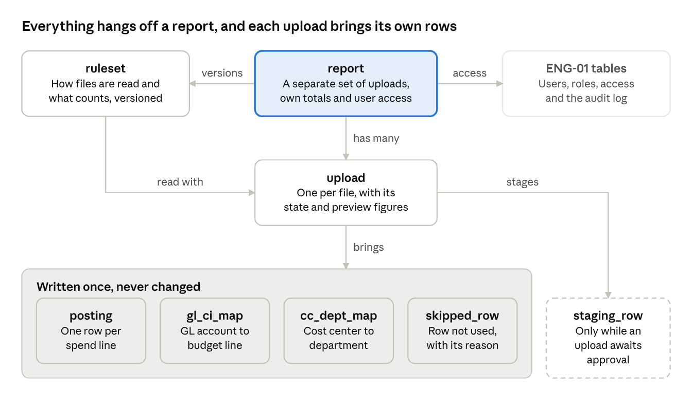
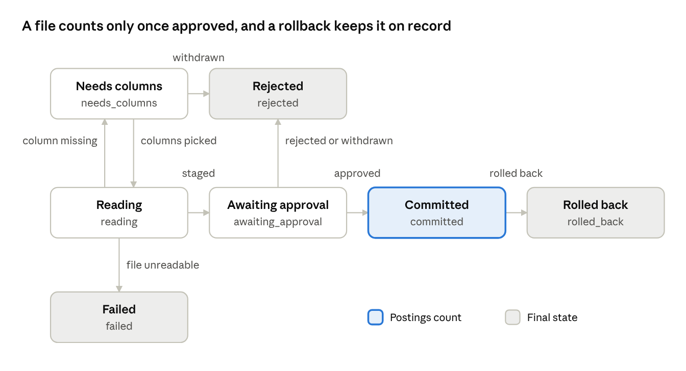

# ENG-02 Data Model and Import

Implements: Phases 1 and 2 of [IDS Spend Audit Delivery Plan](../IDS%20Spend%20Audit%20Delivery%20Plan.md). Builds on [ENG-01](ENG-01%20Architecture,%20Security%20and%20Operations.md).

## 1. Purpose and scope

This document defines where every number comes from: the tables that hold the data, how an uploaded file becomes postings, and the rules that decide what counts. It's written for the finance validator as much as for developers. Every rule here can be checked by hand against a file.

It covers the data model, file reading, cleaning, upload states, duplicates, mapping versions, reconciliation, commit and rollback. Sign-in and access are in ENG-01, and the report screens and exports are in ENG-03.

The rules are written against the agreed file structure: spend lines plus the GL and cost center mapping sheets, all in one file. Until the real export arrives, they're built and tested against the sample file (12.2). Anything marked **Confirm with the real export** may change when the real file arrives. Section 13 lists those items.

## 2. Data model

Everything belongs to a report, and every posting, mapping row and skipped row belongs to the upload it came from. Users, roles, report access and the audit log are defined in ENG-01.

Every arrow points from one row to many: a report has many uploads, and an upload has many postings.

**Written once, never changed.** Postings, mapping rows and skipped rows are only ever inserted. The application's database role, `ids_app`, has no `UPDATE` or `DELETE` on them, the same protection as the audit log (ENG-01, 6.3). Staging rows are the exception: they are deleted once an upload is approved or rejected.

### `posting`: one row per spend line

| Field | Type | Notes |
| --- | --- | --- |
| `id` | bigint |  |
| `report_id` | reference to `report` |  |
| `upload_id` | reference to `upload` | The upload it came from. An upload with postings can't be deleted |
| `sheet`, `row_number` | text, integer | Its place in the original file |
| `company_code`, `fiscal_year`, `document_number`, `line_item` | text, integer, text, text | All optional. **Confirm with the real export** |
| `line_key` | text | The four fields above, cleaned as in Section 5 and joined with `-`, when all four exist, such as `1000-2026-5100000123-1`. Used for duplicates (Section 7) |
| `posting_date` | date | Required, or derived from fiscal year and period |
| `gl_code` | text | Cleaned as in Section 5 |
| `cost_center_code` | text | Cleaned as in Section 5 |
| `value_type` | text | As written in the file, if the file has one |
| `is_actual` | boolean | Set by the ruleset's actual-spend rule (Section 3) |
| `amount` | `numeric(18,3)` | Never empty. Negative for credits |
| `currency` | text | `OMR` |
| `item_text` | text | The line's description, kept as written, Arabic included |

### `upload`: one row per file

| Field | Type | Notes |
| --- | --- | --- |
| `id`, `report_id` |  |  |
| `file_sha256` | text | The stored file's name in the uploads volume |
| `original_name`, `size_bytes` | text, integer |  |
| `uploaded_by`, `uploaded_at` | user, time |  |
| `ruleset_id` | reference to `ruleset` | The settings it was read with |
| `status` | text | One of the states in Section 6 |
| `column_layout` | JSON | Which column held each field, per sheet |
| `period_start`, `period_end` | date | The first and last posting date in the file |
| `control_total`, `control_total_source` | `numeric(18,3)`, text | The total to reconcile against, and whether it came from the file or was entered |
| `rows_read`, `rows_skipped`, `rows_new`, `rows_duplicate`, `rows_replaced` | integer | The preview figures (Section 11) |
| `preview` | JSON | The preview's amounts and exceptions, saved when the preview is built (Section 11) |
| `reconciliation_difference` | `numeric(18,3)` | 0.000 means the file reconciles |
| `decided_by`, `decided_at` | user, time | Approval or rejection |
| `rolled_back_by`, `rolled_back_at` | user, time |  |
| `error` | text | Why it failed, if it did |

An upload changes only through the state changes in Section 6, and each change writes an audit event.

### Mapping tables: one row per code, per upload

| Table | Fields | Rule |
| --- | --- | --- |
| `gl_ci_map` | `upload_id`, `report_id`, `gl_code`, `gl_name`, `ci_code` (may be empty), `ci_name` | One row per GL account in each upload |
| `cc_dept_map` | `upload_id`, `report_id`, `cc_code`, `cc_name`, `dept_code`, `dept_name` | One row per cost center in each upload |

### The other tables

| Table | Holds |
| --- | --- |
| `report` | `id`, `name`, `duplicate_mode` (fixed by the first committed upload, Section 7), `created_by`, `created_at` |
| `ruleset` | `report_id`, `version`, `settings` (JSON), `created_by`, `created_at`. One row per report and version |
| `staging_row` | The same fields as `posting`, plus `is_duplicate`. Rows exist only while an upload awaits approval |
| `skipped_row` | `upload_id`, `sheet`, `row_number`, `reason`, `amount` (if it could be read), and the row's raw values as JSON |

## 3. Reports and rulesets

A report is a separate set of uploads with its own totals and its own user access. Fixed administrators create reports, following the plan's default for its open question on report creation.

Each report has a **ruleset**: the settings that decide how its files are read and what counts. Every upload records the ruleset version it was read with, so any upload can be explained later exactly as it was processed.

| Setting | What it decides | Default |
| --- | --- | --- |
| `header_names` | The header names recognised for each field (Section 4) | The built-in list in Section 4 |
| `actual_spend_rule` | Which value-type values count as actual spend | Every row counts, if the file has no value-type column. This is the plan's default |
| `date_order` | How a date such as `03.04.2026` is read | Day first: 3 April 2026 |
| `currency` | The currency every amount must be in | `OMR` |
| `outside_ids_rule` | Which cost centers are outside IDS | Any cost center missing from the cost center mapping in force (8.1). This is the plan's default |
| `mapping_rule` | Which mapping applies when a code's budget line or department changes between files | The latest committed upload (Section 8). This is the plan's default |

The first four settings act while a file is read, so their effect is stored in its rows. `outside_ids_rule` and `mapping_rule` act whenever the report is shown: `posting_resolved` (8.4) reads them from the report's latest ruleset version.

**Changing a ruleset**

- Only fixed administrators can change a ruleset.
- A change creates a new version. Old versions are never edited.
- A change to a setting that acts while a file is read applies only to uploads made after it. Committed uploads keep the rows, amounts and `is_actual` flags they were read with.
- `outside_ids_rule` and `mapping_rule` can't change once the report has a committed upload, like `report.duplicate_mode` (7.3), or while it has an open upload (Section 6). Otherwise a change would move figures that a preview has already shown.
- To apply new rules to old data, create a new report and upload the files again.
- Every change writes a `ruleset_changed` audit event (ENG-01, 6.3).

**Tested by**

- Changing `mapping_rule` or `outside_ids_rule` is refused while the report has an open or a committed upload. On a report with neither, it creates a new ruleset version and leaves the old one unchanged.
- After `date_order` changes, a committed upload's postings keep their dates, and the next upload is read with the new order.
- A user who isn't a fixed administrator is refused when changing a ruleset.

## 4. Reading the file

### 4.1 Accepted formats

The format is identified from the file's first bytes, never from its name.

| Format | First bytes | Reader |
| --- | --- | --- |
| Excel `.xlsx` | `PK`, which marks a ZIP file | python-calamine, with openpyxl if calamine fails |
| Excel `.xls` | `D0 CF 11 E0` | python-calamine |
| Delimited text | Readable text in UTF-8, or UTF-16 with its byte-order mark | Python's `csv` module, which detects comma, semicolon or tab separators |

A text file named `.xls` is read as delimited text. Anything else, such as HTML or PDF, is refused as an unknown file type. A file whose first characters, after any byte-order mark and spaces, are `<`, `MIME-Version` or `%PDF` is HTML, XML, MHTML or PDF, never text. Text that turns out not to be valid UTF-8 or UTF-16 while it's read ends the upload at `failed` (Section 6). **Confirm with the real export:** some SAP exports are HTML saved as `.xls`. If the client's is, a reader for it is added on Day 2.

A delimited text file holds one table, so it's always a spend sheet. It never has a mapping of its own: commitment item or department columns in it are ignored, unlike on an Excel spend sheet (4.2). Its postings use the mapping in force (8.1).

### 4.2 Finding the sheets

Each sheet is classified by the key fields found in its header row:

| Sheet type | Recognised when its header has | How many |
| --- | --- | --- |
| Spend lines | GL account and cost center | Exactly one |
| GL mapping | GL account, and no cost center or amount | At most one |
| Cost center mapping | Cost center, and no GL account or amount | At most one |
| Anything else | None of the above, such as a README sheet | Ignored |

A sheet's other required fields, such as the amount or the commitment item, are checked after it's classified (4.5). A missing one stops the upload at `needs_columns` instead of hiding the sheet.

If the spend sheet itself has commitment item or department columns, their values build that upload's mappings too. Where they disagree with the mapping sheets, the mapping sheets win, and each disagreement is shown as an exception.

### 4.3 Finding the header row

The header row is searched for in a sheet's first 25 rows. The row that matches the most recognised header names wins, and any title lines above it are ignored. In the sample file, for example, the Transactions header is on row 4, below two title lines.

### 4.4 Matching columns to fields

Before comparing, headers are put in lower case with spaces and punctuation removed, so `G/L Account` and `gl account` match the same name. The ruleset's `header_names` holds the list. These are the built-in names:

| Field | Recognised headers, for example | Required |
| --- | --- | --- |
| GL account | G/L Account, GL Account, GL Acct, Cost Element, Account | Yes, on the spend sheet and the GL mapping sheet |
| Cost center | Cost Center, Cost Centre, Cost Ctr, CCtr | Yes, on the spend sheet and the cost center mapping sheet |
| Amount | Amount in LC, Amount, Value in Local Currency, Val/COArea Crcy | Yes, on the spend sheet |
| Posting date | Posting Date, Pstng Date, Date | Yes, on the spend sheet, unless fiscal year and period are both present |
| Fiscal year, period | Fiscal Year, Year; Period, Posting Period | No |
| Document number | Document Number, DocumentNo, Doc. No. | No |
| Line item | Line Item, Item | No |
| Company code | Company Code, CoCd | No |
| Value type | Value Type | No |
| Currency | Currency, Crcy | No |
| Item text | Item Text, Description, Text | No |
| Commitment item | Commitment Item, Cmmt Item | Yes, on the GL mapping sheet |
| GL account name, commitment item name | G/L Account Name, GL Name; Commitment Item Name, Cmmt Item Name | No |
| Department code | Department Code, Dept Code, Department | Yes, on the cost center mapping sheet |
| Cost center name, department name | Cost Center Name, Cost Centre Name; Department Name, Dept Name | No |

When a sheet has two columns for the same subject, such as `Department Code` and `Department`, the one ending in "code" is the code and the other is the name.

### 4.5 The column check

If a required field isn't found on a classified sheet, the mapping sheets included, or two columns match the same field, the upload stops at `needs_columns` (Section 6). The uploader picks the column for each field from a list showing the file's first rows.

The choice is saved for the report, so the next file with exactly the same headers is matched automatically. Each upload records the layout it used in `upload.column_layout`.

**Tested by**

- In the sample file, the README sheet is ignored and the Transactions header is found on row 4.
- An HTML file renamed to `.xlsx`, a PDF renamed to `.xls` and an MHTML file saved as `.xls` are each refused.
- A semicolon-separated CSV file is read correctly.
- A CSV with a Commitment Item column, uploaded after the Excel sample, leaves every GL account's budget line as the Excel file mapped it.
- A file with no amount column stops at `needs_columns`.
- A GL mapping sheet whose commitment item header isn't recognised stops at `needs_columns`.
- A file with both Posting Date and Document Date columns uses Posting Date.

## 5. Cleaning rules

Every value is cleaned the same way every time, and a value that can't be cleaned is never guessed. Its row is skipped with a reason and shown in the preview.

| Field | Rule | Examples |
| --- | --- | --- |
| Codes (GL account, cost center, commitment item, department, company code, document number, line item) | Read as text and trim spaces. A number Excel stored as `4510.0` becomes `4510`. Leading zeros are removed from all-digit codes, and letters are upper-cased | `0000610100` → `610100`; `4510` → `4510`; `ab12` → `AB12` |
| Fiscal year, period | Read as whole numbers. A number Excel stored as `2026.0` becomes `2026` | `2026.0` → `2026`; `003` → `3` |
| Amount, from an Excel number | Converted through its shortest text form, never straight from the binary value | `1234.5` → `1234.500` |
| Amount, from text | Thousands separators and currency letters are removed. A trailing minus, a leading minus or brackets each mean negative | `1,234.500-` → `-1234.500`; `(300.000)` → `-300.000`; `OMR 1,200` → `1200.000` |
| Amount, precision | More than 3 decimal places is never rounded. The row is skipped | `12.3456` → skipped |
| Date, from an Excel date cell | Used as it is |  |
| Date, from text | `dd.mm.yyyy`, `dd/mm/yyyy` and `dd-mm-yyyy` are read day first (the ruleset's `date_order`). `yyyy-mm-dd` is also accepted, and a two-digit year means 20yy | `03.04.2026` → 3 April 2026 |
| Date, from an Excel serial number | Numbers between 20000 and 80000 in a date column are read as Excel day numbers | `46082` → 1 March 2026 |
| Date, from fiscal year and period | Used only when there's no date column. Periods 1 to 12 become the first day of that month, and periods 13 to 16 become 31 December. **Confirm with the real export** that the fiscal year is the calendar year | Year 2026, period 3 → 1 March 2026 |
| Value type | Trimmed, lower-cased and compared with the ruleset's `actual_spend_rule`. Rows that aren't actual spend are kept with `is_actual` false, and never counted as spend |  |
| Currency | With no currency column, OMR is assumed. A row in another currency is skipped | `USD` → skipped |
| Item text | Trimmed, and otherwise kept exactly as written, Arabic included. Stored as UTF-8 |  |

**When a row is skipped**

A **spend row** is any row with both a GL account and a cost center. Rows without both, such as totals, subtotals and labels, are never spend.

| Row | Example | Counts in reconciliation (Section 9) |
| --- | --- | --- |
| Completely blank | All cells empty | Not recorded at all |
| The total row | No GL account or cost center, an amount, and the word Total in a cell | It **is** the control total |
| Other rows without a GL account or cost center | A subtotal or a label | No. Listed in the preview |
| Spend row with an invalid date | `31.02.2026` | Yes |
| Spend row with more than 3 decimal places | `12.3456` | Yes |
| Spend row with an unreadable code | `#N/A` as the GL account | Yes |
| Spend row repeating a line key already in the same file | Same document and line item twice | Yes (Section 7) |
| Spend row in another currency | `USD` | No, and approval is blocked: a file mixing currencies can't reconcile in OMR. **Confirm with the real export** which amount column holds local currency |

**Tested by**

- A property test writes thousands of random amounts in SAP's formats and checks that each one reads back as the same `Decimal`.
- Cleaning a code that's already clean leaves it unchanged.
- Every row below the sample file's header ends up clean, skipped with a reason, or listed in the preview as the total row, a subtotal or a label. Only blank rows are left out, and none is lost.
- `31.02.2026`, `12.3456` and a `USD` row are each skipped with the right reason.
- The same line read from Excel number cells and from CSV text gets the same `line_key`.

## 6. Upload states

An upload moves only through the changes below, and each change writes an audit event (ENG-01, 6.3). Reading runs inside the upload request (ENG-01, 5.1).

Any change not drawn is refused. Committed is the only state whose postings count.

| State (`upload.status`) | What it means | Moves to | Who moves it |
| --- | --- | --- | --- |
| `reading` | The file is stored and hashed, and is being read, cleaned and staged | `needs_columns`, `awaiting_approval` or `failed` | The app |
| `needs_columns` | A required field wasn't found (4.5) | `reading` again, once the columns are picked | The uploader |
|  |  | `rejected`, if withdrawn | The uploader |
| `awaiting_approval` | Rows are staged and the preview is ready (Section 11) | `committed` | A user with **approve** |
|  |  | `rejected` | A user with **approve**, or the uploader withdrawing it |
| `committed` | The postings are written and count in the report | `rolled_back` | A user with **roll\_back** (Section 10) |
| `rejected` | No postings were written, so the report didn't change | Final |  |
| `failed` | The file couldn't be read: it was damaged, it couldn't be opened in the format its first bytes showed, or it had no spend sheet | Final |  |
| `rolled_back` | The postings are kept but no longer count (Section 10) | Final |  |

**Rules**

- **Refused before an upload exists.** A file is refused at the request, and no upload is created, when the user lacks **upload**, the file is over `MAX_UPLOAD_MB`, its first bytes aren't an accepted format (4.1), it matches a committed upload (7.1), or the report has an open upload.
- **One open upload per report.** While an upload is at `reading`, `needs_columns` or `awaiting_approval`, a new file for the same report is refused with a message naming the open one. A preview's duplicate and replacement figures are worked out against the committed postings, and a second commit would make them wrong.
- **No rollback during an open upload.** A rollback is refused while the report has an open upload, for the same reason.
- **Rejecting and withdrawing need a reason.** It's kept in the audit event.
- **Approving your own upload.** A fixed administrator, or a user whose role holds both **upload** and **approve**, can approve their own upload. Who holds both is decided by the permissions an administrator gives (ENG-01, 6.2), and the audit log records both actions.
- **An interrupted read.** If the app stops while a file is being read, nothing is staged, because reading runs in one transaction. The upload stays at `reading`, and any upload at `reading` for more than 10 minutes is marked `failed`, with the error "Reading was interrupted", the next time the report's uploads page opens.
- **What's kept.** Skipped rows and mapping rows are saved when reading ends at `awaiting_approval`, in the same transaction as the staging rows. An upload that stops at `needs_columns` saves none, so reading it again can't save them twice. They're kept whatever happens to the upload next, so a rejected file can still be explained. Staging rows are deleted when an upload leaves `awaiting_approval` or fails.
- **Trying again.** A failed or rejected file can be uploaded again as a new upload.

**Tested by**

- Every change in the table works, and every other change is refused, such as `rejected` to `committed`.
- A second file for a report with an open upload is refused.
- A user without **approve** can't commit, and the uploader can withdraw.
- An upload stopped during reading leaves no staging rows and is later marked `failed`.
- Reading an upload again after its columns are picked saves each skipped row and mapping row once.

## 7. Duplicates

The same spend must never count twice. Duplicates are caught at three levels.

### 7.1 The same file twice

A file whose `file_sha256` matches a committed upload in the same report is refused before an upload is created, with the message "This file was already committed on *date* as upload *n*." The same file can go into a different report, and a file whose upload was rolled back can be uploaded again.

### 7.2 The same line twice in one file

When two spend rows in one file have the same `line_key`, the second is skipped with the reason "repeats row *n*". It still counts in reconciliation (Section 9), because the file's own total includes it.

### 7.3 Lines already in the report

Each report uses one of two modes, set in `report.duplicate_mode`.

|  | Replace by period (the default) | Line key |
| --- | --- | --- |
| Used when | Always, unless line-key mode is chosen | The approver chooses it in the first upload's preview. It's offered only when every spend row has a full `line_key` |
| What committing does | Every posting already in the report dated in the file's months is replaced. The months run from the month of `period_start` to the month of `period_end` | Rows whose `line_key` matches a posting that counts are marked `is_duplicate` and not committed. Only new lines are added |
| Suits | Year-to-date exports, where each file restates every month it covers | Exports that overlap irregularly |
| Preview shows | The months replaced, and the number and amount of postings replaced | The number and amount of duplicates |
| A posting that disappears from a later export | Disappears from the report too | Stays in the report |
| Rows without a full line key | Accepted | Skipped with the reason "no line key", and counted in reconciliation |

The mode can't change once a report has a committed upload. A report's first upload means any upload made before the report's first commit (10.1), such as a new try after a rejected file. Nothing is in the report yet, so both modes give the same preview figures.

Replacement never deletes or edits a posting. A replaced posting simply stops counting (Section 10.2), so rolling back the upload that replaced it makes it count again.

In line-key mode, a duplicate whose amount differs from the posting already in the report is shown as an exception. The posting already in the report stays as it is.

**Tested by**

- The same file twice in one report is refused, and accepted in another report.
- In replace-by-period mode, a September year-to-date file followed by an October one leaves exactly the October file's postings for January to October.
- In line-key mode, a second file overlapping the first adds only its new lines.
- A line repeated in one file is skipped once, and the file still reconciles.

## 8. Mapping versions and resolution

A posting stores only its GL account and cost center. Its budget line and department are looked up whenever a report is shown, from the mapping in force. A mapping change therefore never edits a posting, and every past mapping stays on record with the upload that brought it.

### 8.1 The mapping in force

The GL mapping and the cost center mapping are resolved separately, by the ruleset's `mapping_rule`.

| `mapping_rule` | Which mapping applies |
| --- | --- |
| `latest` (the default) | The mapping of the most recently committed upload that has that mapping, whole. A code missing from it is unmapped, even if an older file mapped it |
| `own_upload` | Each posting uses the mapping from its own upload. If its upload had none, the `latest` rule applies |

Rolled-back uploads are never used. Mapping values taken from the spend sheet itself (4.2) count as part of that upload's mapping.

### 8.2 What a posting gets

| Case | Budget line shown | Department shown | In the sample file |
| --- | --- | --- | --- |
| GL account and cost center both mapped | Its commitment item | Its department | Most rows |
| GL account missing from the GL mapping | No budget line | As mapped | `640200` |
| GL account listed with an empty commitment item | No budget line, marked "listed without a commitment item" | As mapped | `650200` |
| Cost center missing from the cost center mapping | As mapped | Outside IDS, by the default `outside_ids_rule` | `3100`, `3200` |

Outside-IDS postings stay in the data. Reports flag them and can exclude them (ENG-03).

### 8.3 Catching changes

The preview compares the upload's mappings with the mappings in force, and lists each difference as an exception, with the spend it affects:

- a GL account whose commitment item changes
- a cost center whose department changes
- a code added, or a code that the new mapping no longer lists

With the `latest` rule, approving moves postings that are already committed too, and the preview says so: for example, "Approving moves 12,400.000 OMR from 2101 to 2401, including 9,100.000 OMR already committed." Rolling the upload back moves them back.

On a report with no committed upload, no mapping is in force to compare with, so the preview lists no mapping changes. It lists none either for a GL or cost center mapping the upload doesn't have (8.1). Instead, the preview names the upload whose mapping applies. If no committed upload has that mapping yet, the preview says so, and its postings show No budget line or Outside IDS (8.2).

### 8.4 The resolved view

Reports never join the tables themselves. A database view, `posting_resolved` in `sql/`, joins each posting that counts (Section 10.2) to its mapping in force. Every report, chart and export reads from it (ENG-03), so all of them follow the same rules.

**Tested by**

- In the sample file, `640200` shows no budget line, `650200` shows listed without a commitment item, and `3100` and `3200` show outside IDS.
- A second file moving `610100` to another commitment item shows the move and its amount in the preview. After approval, every `610100` posting reports under the new item, and after rollback, under the old one.
- A second file whose mapping leaves out a cost center makes that cost center outside IDS under `latest`.

## 9. Reconciliation

Reconciliation proves the file was read completely: every amount in it is either staged or skipped with a reason, and together they add up to the file's own total.

### 9.1 The control total

- **From the file.** The total row (Section 5) on the spend sheet. If more than one row qualifies, the last one below the last spend row is used. `control_total_source` is `file`.
- **Entered.** If the file has no total row, the uploader types the total shown in SAP for the same selection. `control_total_source` is `entered`, and the preview shows it as typed by hand.

Excel adds tiny binary errors when it sums, such as `1234.5000000001`. So the difference (9.2) is worked out from the control total as read, before any rounding. The difference is then rounded to 3 decimal places, which removes only fractions of a baisa. A file with a skipped amount such as `12.3456` still reconciles. `control_total` is saved rounded the same way. Spend rows are never rounded (Section 5).

### 9.2 The formula

The staged rows include every spend row, actual or not, because the file's total includes them all.

| Line | From |
| --- | --- |
| Control total | 9.1 |
| minus staged rows to commit | Staging rows not marked `is_duplicate` |
| minus duplicates already in the report | Staging rows marked `is_duplicate` (line-key mode only) |
| minus skipped spend rows | Skipped rows that count in reconciliation (Section 5), with a readable amount |
| **= Difference** | Saved as `upload.reconciliation_difference` |

### 9.3 When approval is blocked

| Condition | Why |
| --- | --- |
| The difference isn't exactly `0.000` | Some amount in the file is unexplained. There's no tolerance |
| There's no control total | Nothing to reconcile against |
| A row is in another currency (Section 5) | The file can't reconcile in OMR |

A skipped spend row whose amount can't be read leaves a difference, so it blocks approval through the first condition.

Skipped rows count in reconciliation only to prove the file was read completely. They're never in the report. A file's actual spend in the report is therefore its control total minus three amounts. They're its skipped spend rows, its duplicates already in the report (line-key mode), and its rows to commit that aren't actual spend. No row is in more than one, and the preview shows each (11.1).

**Tested by**

- The sample file reconciles to `0.000`.
- Changing one amount by `0.001` blocks approval.
- A file with no total row asks for one, and the typed total is saved with `control_total_source` as `entered`.
- A file of actual-spend rows with one skipped row reconciles, and its report total is lower by exactly that row's amount.

## 10. Commit and rollback

### 10.1 Commit

Approval runs as one database transaction. Either every step happens or none does.

1. Lock the report's row, so two approvals for the same report can't run at once.
2. Check that the user still has **approve**, that the upload is still at `awaiting_approval`, and that nothing in 9.3 blocks it.
3. Check that no upload in the report was committed or rolled back since the preview was built. If one was, stop and rebuild the preview.
4. Copy the staging rows not marked `is_duplicate` into `posting`.
5. Check that the count and total of the new postings equal the preview's. If they don't, stop.
6. Set the upload to `committed` with `decided_by` and `decided_at`. On the report's first commit, also set `report.duplicate_mode` to the mode chosen in the preview (7.3). Write the audit event, with the duplicate mode in its details on a first commit.
7. Delete the upload's staging rows.

If the transaction stops at any step, nothing is written, the upload stays at `awaiting_approval`, and the error is shown. Because the audit event is in the same transaction, a commit can't happen without its audit event.

### 10.2 Which postings count

A posting counts when both are true:

- its upload is `committed`, not `rolled_back`, and
- in replace-by-period mode, no upload committed after it covers the posting's month.

**Actual spend** is the postings that count with `is_actual` true. Whether a posting counts is never stored. It's worked out by `posting_resolved` (8.4) from the uploads' states and order, so a rollback changes it without touching a posting.

### 10.3 Rollback

- **Only the latest.** Only the most recently committed upload of a report can be rolled back. To undo older ones, roll back newer ones first, newest first. Replacement and mappings depend on the order of uploads, and undoing in reverse order always returns the report to a state it was really in.
- **Who and why.** It needs **roll\_back** and a reason, which is kept in the audit event. It's refused while the report has an open upload (Section 6).
- **What changes.** The upload is set to `rolled_back` with `rolled_back_by` and `rolled_back_at`. Nothing is deleted: its postings, mapping rows and skipped rows stay, and its history can still be viewed.
- **What it restores.** The postings it replaced count again, and the mappings in force go back to those before it (Section 8). Every report figure returns to exactly what it was before the commit. The confirmation screen shows the change first, for example "Actual spend: 1,250,400.000 OMR → 1,198,200.000 OMR."
- **After a rollback.** The file can be uploaded again (7.1).

**Tested by**

- Stopping the process during a commit leaves the upload at `awaiting_approval` with nothing written.
- After a commit, the report total equals the previous total, minus the replaced postings, plus the new ones.
- After a rollback, every figure in `posting_resolved` equals its value before the commit.
- Rolling back an older upload while a newer one is committed is refused.
- An `UPDATE` or `DELETE` on `posting` as `ids_app` is refused by the database.

## 11. Exceptions and the preview

The preview is the approver's whole view of a file before it counts. It's built when reading ends, and its figures and exceptions are saved with the upload, so the preview of any past upload, rejected ones included, can be shown again exactly as it was.

### 11.1 The preview figures

| Figure | Shows | Saved in |
| --- | --- | --- |
| File | Name, size, uploader, time, ruleset version | `upload` |
| Period | First and last posting date, and the months replaced (replace-by-period mode) | `period_start`, `period_end` |
| Rows | Read, to commit, duplicates, replaced and skipped | `rows_*` |
| Amounts | The amount for each row figure above | `preview` |
| Reconciliation | The formula in 9.2, line by line, with the difference | `control_total`, `reconciliation_difference` |
| Actual spend in this file | Total, inside IDS and outside IDS | `preview` |
| Not actual spend | The amount of the rows to commit with `is_actual` false (9.3) | `preview` |
| Report actual spend | Before and after approval | `preview` |
| Exceptions | Each type below, with its rows, row count and amount | `preview` |

Each exception lists the rows it covers, by sheet and row number in the original file.

### 11.2 Exception types

| Exception | Example | Blocks approval |
| --- | --- | --- |
| Difference not zero | `-0.500` | Yes |
| No control total | No total row, and none typed | Yes |
| Row in another currency | `USD` | Yes |
| Skipped spend row | Invalid date, more than 3 decimals, unreadable code, repeated line, no line key | No |
| Other row without GL account or cost center | A subtotal or a label | No |
| GL account with no budget line | `640200` | No |
| GL account listed without a commitment item | `650200` | No |
| Cost center outside IDS | `3100` | No |
| Mapping change | `610100` moves from `2101` to another commitment item | No |
| Mapping sheet and spend sheet disagree | 4.2 | No |
| Value type not seen before in this report | `Actual Spend` where the rule says `Actual` | No |
| Duplicate with a different amount | Line-key mode, 7.3 | No |
| A month with no rows inside the replaced months | February empty between January and March | No |

An exception that doesn't block approval still needs a look. The approver approves the file with its exceptions, and the audit event records how many there were of each type.

While a report has no committed upload, "Value type not seen before in this report" isn't raised. The preview lists the value types found instead, with whether each counts as actual spend.

**Tested by**

- The sample file's preview shows exactly the exceptions its README describes: `640200`, `650200`, `3100` and `3200`, and its subtotal rows as other rows without a GL account or cost center (12.3).
- Each exception type shows once, with the right rows, in a file built to cause it. The types that need an earlier upload (mapping change, value type not seen before, duplicate with a different amount, a month with no rows) use a pair of files in a report of the right mode.
- The preview of a rejected upload shows the same figures as before it was rejected.

## 12. Testing

Each section above ends with the tests that prove it. This section is how they're organised.

### 12.1 Kinds of test

| Kind | Covers | Tool |
| --- | --- | --- |
| Unit | Cleaning rules, header matching, sheet classification, line keys | pytest |
| Property | Amounts and codes read back unchanged. Every row of a random file in OMR with readable amounts ends up staged or skipped, and the file reconciles | Hypothesis |
| Golden file | A whole file from upload to report figures, compared with an expected result | pytest |
| Database | Commit, rollback, replacement, `posting_resolved` and the `ids_app` grants, on a real PostgreSQL | pytest-django |
| Browser | Upload, preview, approve, report and rollback, as a user would | Playwright |

### 12.2 Golden files

Each golden file has an expected result beside it: totals by GL account, by commitment item and by department, the outside-IDS total, the skipped rows with reasons, and the reconciliation. The expected results are worked out independently of the app. For the sample file, they come from the script that generated it (12.3). The sample file imitates an SAP G/L line item export (transaction FAGLL03), with the two mapping sheets added, so that moving to the real export changes as little as possible.

| File | Proves |
| --- | --- |
| The sample file (12.3) | Title lines, the README sheet, subtotal rows, zero-padded codes, `640200`, `650200`, `3100` and `3200`, and a total that reconciles |
| The sample saved as semicolon-separated text (12.3) | Uploaded after the Excel sample into the same report, it gives the same figures, using the Excel file's mappings |
| Messy amounts | Trailing minus, brackets, thousands separators, Excel serial dates |
| Bad rows | An invalid date, 4 decimals and `#N/A`, each skipped with its reason, and a total that still reconciles |
| A row in another currency | A `USD` row blocks approval, so its expected result is the preview alone |
| Two year-to-date files | Replace by period |
| Two overlapping files with line keys | Line-key mode |
| A changed mapping | A GL account moving budget line, before and after rollback |
| The real export | Added once it arrives. During the build, its expected result is SAP's own totals delivered with it: the overall total and the named GL accounts. The validator's hand-checked figures are added at acceptance |

A golden result changes only on purpose, in its own commit, with the reason in the commit message. A rule change that moves any number fails the tests until then.

The real export is client data, so it never goes into the repository. Its test reads it from a local folder outside the repository, and is skipped when the folder isn't there.

### 12.3 The sample file

A script, `tests/fixtures/make_fixtures.py`, makes the sample file and its semicolon-separated copy. It starts from a table of true values, such as `610100`, `4510`, `12400.000` and 4 January 2026. It writes them the way SAP does, and works out the expected results from the same table with `Decimal`. It never reads its own files back and never imports from `ids_audit`, so a bug in the app can't also hide in the expected results.

The sample looks like a real export but has no bad rows. Invalid dates, `#N/A`, extra decimals and other currencies have golden files of their own (12.2). Every spend row in it is clean and counts.

**Sheets**

| Sheet | Holds |
| --- | --- |
| README | Sentences in column A: that the file is made up, how to make it again, and every exception and subtotal row it contains. It has no recognised header, so it's ignored (4.2) |
| Transactions | The title on row 1, the selection on row 2 ("Company code 1000, posting date 01.07.2025 to 30.06.2026"), row 3 blank, and the header on row 4. Then the spend rows, sorted by GL account and posting date, with a subtotal row after each GL account and the total row last |
| GL Mapping | G/L Account, G/L Account Name, Commitment Item, Commitment Item Name |
| Cost Center Mapping | Cost Center, Cost Center Name, Department Code, Department Name. IDS cost centers only |

**Transactions columns**

| Header | Written as |
| --- | --- |
| CoCd | Text: `1000` |
| G/L Acct | Text, zero-padded to 10 digits: `0000610100` |
| DocumentNo | Text, 10 digits: `5100000123`, and `0100000045` for journals |
| Line Item | Text, 3 digits: `002` |
| Type | Text: `KR` for an invoice, `KG` for a credit memo, `SA` for a journal. Not read (4.4) |
| Doc. Date | Text, `dd.mm.yyyy`. Not read (4.4) |
| Pstng Date | Text, `dd.mm.yyyy` |
| Year | A number cell: the fiscal year, which is the calendar year (13, item 8) |
| Period | A number cell: the month |
| Cost Ctr | Text, zero-padded to 10 digits: `0000004510` |
| Reference | Text: the vendor's invoice number. Not read (4.4) |
| Text | As written. Three rows are in Arabic |
| Amount in LC | Text, as SAP writes it: `12,400.000`, `1,250.000-` |
| LCurr | Text: `OMR`. The header isn't recognised (4.4), so OMR is assumed (5) |

A subtotal row holds only the G/L Acct, the amount and `OMR`. The total row holds `Total` in column A, the sum of every spend row, and `OMR`. It's a value, not a formula: XlsxWriter doesn't calculate formulas, and saves their result as `0`.

On the mapping sheets, codes are number cells, so `4510` stored as a number must match `0000004510` stored as text (5).

**Codes**

| Commitment item | GL accounts |
| --- | --- |
| `2101` Software and licences | `610100` Software licences, `610200` Software support, `610300` Cloud services |
| `2201` Hardware | `620100` Hardware purchases, `620200` Hardware maintenance |
| `2301` Telecom and network | `630100` Telecommunications, `630200` Data lines |
| `2401` Professional services | `640100` IT consulting |
| `2501` Training and other | `650100` IT training, `660100` IT supplies |
| Listed with an empty commitment item | `650200` Conferences and travel |
| Not on the GL Mapping sheet | `640200` IT contractors |

| Department | Cost centers |
| --- | --- |
| `APP` Applications | `4510` Application development, `4520` Enterprise applications |
| `INF` Infrastructure | `4530` Data center, `4540` Network |
| `SEC` Cyber security | `4550` Security operations |
| `GOV` IT governance | `4560` IT governance office |
| Not on the Cost Center Mapping sheet | `3100` and `3200`, outside IDS |

**Cases**

| Rows | Prove |
| --- | --- |
| `640200` on IDS cost centers, and one row on `3200` | No budget line (8.2). The `3200` row is in both exception lists and counts once in every total |
| `650200` | Listed without a commitment item (8.2) |
| `3100` on `610100` | Outside IDS on a mapped GL account (8.2), and the outside IDS filter (ENG-03, 3.1) |
| Document date 28.12.2025, posting date 04.01.2026 | The posting date is used (4.4), by the year filter too (ENG-03, 3.1) |
| One document with lines `002` and `003` | The line item is part of `line_key` (2) |
| Document `5100000123` in fiscal years 2025 and 2026 | The fiscal year is part of `line_key` |
| Journals numbered `0100000045` | Leading zeros are removed from document numbers (5) |
| Three item texts in Arabic | Kept as written (5), and shown right to left (ENG-03, 6.2) |
| `1,150,000.000` | Thousands separators (5) |
| Amounts that use all three decimals, such as `3,456.789` | Totals are exact (5) |
| Credits with a trailing minus, on several GL accounts | Negative amounts (5) |
| A posting dated `03.04.2026` | Dates are read day first (5) |
| `610100` is the largest GL account, spread over several departments and `3100` | Spend by cost center and department on the GL account screen (ENG-03, 4) |
| `620200`: a `2,000.000` cost and a `3,500.000-` credit memo | A GL account with a negative total |
| Postings in every month from July 2025 to June 2026, and spend in every department | Months and the running total (ENG-03, 5 and 7), with no empty month (11.2) |
| 12 GL accounts, each with a different total | The overview's 10 largest and one row for all the others (ENG-03, 4) |

**Files**, all in `tests/fixtures/`

| File | Holds |
| --- | --- |
| `make_fixtures.py` | The script. `uv run python -m tests.fixtures.make_fixtures` makes every file below again |
| `sample.xlsx` | The four sheets |
| `sample.expected.json` | Its expected result, as the first upload into an empty report |
| `sample_semicolon.csv` | The Transactions sheet as text: `;` between fields, UTF-8 with a byte-order mark, CRLF line endings, and every line padded to 14 fields, so line *n* is Excel row *n*. Values are as on the sheet |
| `sample_semicolon.expected.json` | Its expected result when uploaded after `sample.xlsx` into the same report: the same figures, using the Excel file's mappings (8.1), with every posting of `sample.xlsx` replaced (7.3) |

**Expected result**

Each expected result is a JSON object. Every amount is a string with three decimal places, such as `"12400.000"`, so reading it never passes through a float.

| Key | Holds |
| --- | --- |
| `fixture`, `scenario` | The file name, and the upload it describes |
| `header_row` | `4` |
| `rows` | `to_commit`, `skipped`, and `other` for the subtotal rows |
| `period` | `first_posting` and `last_posting` (11.1) |
| `reconciliation` | `control_total`, `to_commit`, `skipped` and `difference` (9.2) |
| `actual_spend` | `total`, `inside_ids` and `outside_ids` (11.1) |
| `by_gl`, `by_ci`, `by_department`, `by_month` | Actual spend per GL account, per commitment item with `none` for no budget line, per department with `outside` for outside IDS (ENG-03, 6.1), and per posting month as `2025-07` |
| `exceptions` | `missing_from_gl_mapping`, `listed_without_ci` and `outside_ids`: each code's amount and Transactions row numbers. `other_rows`: the subtotal row numbers |
| `skipped_rows` | Empty |
| `replaced` | The CSV only: the number and amount of postings replaced (7.3) |

Running the script again gives byte-identical files. The workbook's creation date is fixed, and Git never changes the fixtures' line endings (`docs/CONTRIBUTING.md`, section 9).

**Tested by**

- Running the script again leaves every file in `tests/fixtures/` byte for byte unchanged.
- In each expected result, `by_gl`, `by_ci`, `by_department` and `by_month` each add up to `actual_spend.total`, so do `inside_ids` and `outside_ids`, and the reconciliation `difference` is `0.000`.

**Done when** every test passes on a clean checkout with `uv run pytest`, and the sample file's totals match its expected result to the baisa. Once the real export arrives, its overall and GL totals must also match SAP's to the baisa.

## 13. To confirm against the real export

Every assumption the rules above depend on is listed here, including each one marked **Confirm with the real export**. Items confirmed by opening the file are checked when it arrives. Until then, the sample file follows each assumption as written. The others are questions for the client, needed by the day shown, which follows the plan's open questions. Until an answer arrives, the plan's default is what gets built. Each change goes into the part that owns it: reading, cleaning and counting (Phase 1), or duplicates and the control total (Phase 2).

| # | Assumption | Section | Confirmed by | If it's different |
| --- | --- | --- | --- | --- |
| 1 | The file is a real Excel file, not HTML saved as `.xls` | 4.1 | Opening the file | Add an HTML table reader |
| 2 | The headers match the built-in names | 4.4 | Opening the file | Add the names to `header_names` |
| 3 | The GL and cost center mapping sheets are in the file, and the cost center sheet lists only IDS cost centers | 4.2, 8.2 | Opening the file, and the client by Day 2 | Set `outside_ids_rule` to the rule the client gives, before the report's first commit (Section 3) |
| 4 | Company code, fiscal year, document number and line item are in the file | 2, 7.3 | Opening the file, and the client by Day 3 | Line-key mode isn't offered. Replace by period is used |
| 5 | The amount column is in local currency (OMR) | 5 | The client, by Day 2 | Point the amount field at the local-currency column |
| 6 | Credits are negative amounts in the amount column | 5 | Opening the file | Read SAP's debit and credit column (S or H), and make H amounts negative |
| 7 | Dates are day first, or real date cells | 5 | Opening the file | Change `date_order` |
| 8 | The fiscal year is the calendar year, if there's no date column | 5 | The client, by Day 2 | Map periods to the fiscal calendar |
| 9 | Which value-type values mean actual spend | 3, 5 | The client, by Day 2 | Set `actual_spend_rule` |
| 10 | Each export is year-to-date, or covers whole months | 7.3 | The client, by Day 3 | Use line-key mode, if item 4 allows it |
| 11 | The spend sheet has a total row | 9.1 | Opening the file, and the client by Day 3 | The uploader types the total from SAP |
| 12 | The date, document number and line item columns hold SAP's posting date, accounting document number and its line item, not the document date, the reference or a purchasing item | 4.4 | Opening the file | Point those fields at the right columns in `header_names` |
| 13 | The export is SAP's G/L line item report (FAGLL03), laid out like the sample file | 4.4, 12.2 | The client, before acceptance | Add the real report's header names to `header_names`, and update the sample file to match |
