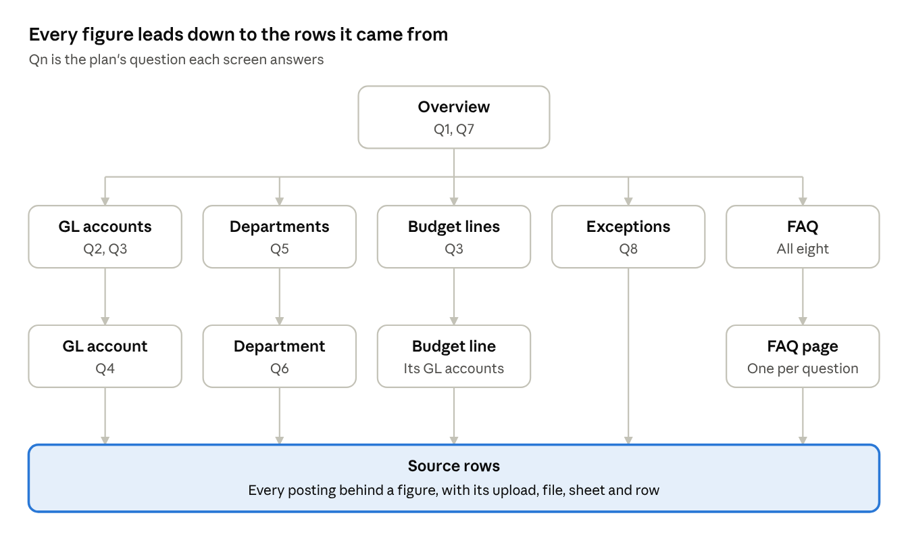

# ENG-03 Reports, FAQ and Exports

Implements: Phase 3 of [IDS Spend Audit Delivery Plan](../IDS%20Spend%20Audit%20Delivery%20Plan.md). Builds on [ENG-01](ENG-01%20Architecture,%20Security%20and%20Operations.md) and [ENG-02](ENG-02%20Data%20Model%20and%20Import.md).

## 1. Purpose and scope

This document defines what each screen, FAQ page and export shows, and exactly how each figure is calculated. It's written for the validator, who checks the figures against SAP, and for the developer.

It covers where every figure comes from, the filters, the screens, the charts, drill-down to source rows, the FAQ pages, the exceptions screen, the Excel export, speed and testing. Which postings count, and how they get there, is in ENG-02. Sign-in, permissions and the audit log are in ENG-01.

The FAQ pages follow the plan's eight default questions until the client sends the final list, due by the start of Day 4. Section 12 lists that and the other items still to confirm.

## 2. Where every figure comes from

Every figure on every screen, FAQ page and export comes from one set of functions in `reports/queries.py`, run over `posting_resolved` (ENG-02, 8.4). PostgreSQL adds the amounts as exact decimals. No view, template or chart adds amounts itself, and `manage.py report_totals` (ENG-01, 7.2) calls the same functions. The functions for the total and the groups in 2.3 are built in Phase 1, for its gate. The rest of this document is Phase 3 (ENG-01, 4, Build order).

### 2.1 What's counted

Every figure starts from the same rows:

| Condition | Why |
| --- | --- |
| The posting counts (ENG-02, 10.2) | Rolled-back and replaced postings never appear |
| `is_actual` is true | Only actual spend is spend |
| It belongs to the report in the address | Each report is separate |
| It matches the filters (Section 3) | The screen says which filters are on |

### 2.2 Measures

| Measure | Definition |
| --- | --- |
| Actual spend | The sum of `amount` over the rows above |
| Lines | The number of those rows |
| Share | A group's actual spend divided by the total under the same filters, rounded half up to one decimal place. Shares aren't adjusted to add up to exactly 100.0%. When that total is zero or negative, there's no share: the screen shows `–` and the export leaves the cell empty, since a share of a total that isn't spend would mislead |
| Running total | Actual spend added up month by month, in posting-date order, from the first month the filters include |

A sum over no rows is `0.000`, never empty. Each share is worked out in `reports/queries.py` from the two sums PostgreSQL returns, with `Decimal`, so no screen or template divides.

### 2.3 Groups

| Group by | Key | Name shown | Catch-all group |
| --- | --- | --- | --- |
| GL account | `gl_code` | From the GL mapping in force (ENG-02, 8.1) | None: every posting has a GL account |
| Budget line | `ci_code` | From the GL mapping in force | No budget line |
| Cost center | `cost_center_code` | From the cost center mapping in force | None: every posting has a cost center |
| Department | `dept_code` | From the cost center mapping in force | No department, for a cost center inside IDS that its mapping row gives no department code (ENG-02, 5 keeps such a row). Outside IDS, for a cost center outside IDS |
| Month | Month of `posting_date` | `Mar 2026` | None |

Every posting falls into exactly one group, so the groups on a screen always add up to its total. A code with no name in the mapping is shown as the code alone. Within one upload's mapping, each code has one name, the first one given (ENG-02, 5, Mapping rows). The `own_upload` rule (ENG-02, 8.1) can give one code names from different uploads' mappings, and the group then shows the name that sorts last, so it still has one row.

**Several in force at once.** Under `own_upload`, one GL account's postings can also get different budget lines, and one cost center's different departments, from different uploads' mappings. A list of GL accounts then shows "Several (*n*)" as that account's budget line, and the GL account screen splits its spend by budget line, one row each. A list that shows a cost center with its department gives each pair a row of its own. Under the default `latest` rule, each code has one budget line or department, so this never shows.

**The functions.** Every function takes the report and the filters (Section 3), and the detail screens' functions also take the keys of 6.1, so a figure and its drill-down count the same rows. `totals` returns the actual spend in all, inside IDS and outside IDS, and its lines. `by_gl_account`, `by_budget_line`, `by_department` and `by_month` each return one group per key: its key, the name shown, its actual spend and its lines. A catch-all's key is the value its address uses (6.1): `none` for No budget line and for No department, and `outside` for Outside IDS. A clean code is never lower case (ENG-02, 5), so a catch-all is never taken for a code. Groups come in key order with the catch-alls last, and a screen sorts them as Section 4 says. Outside IDS is decided by `is_outside_ids` (ENG-02, 8.4), so a cost center inside IDS with no department code is in No department, never Outside IDS. Each function runs one query, with every sum and count done by PostgreSQL (Section 10).

### 2.4 Formats

| Value | Format | Example |
| --- | --- | --- |
| Amount | OMR, 3 decimal places, comma for thousands, minus for negatives | `-1,250.000` |
| Share | One decimal place | `12.4%` |
| Date | Day first, as in SAP exports | `03.04.2026` |
| Time | Muscat time | `03.04.2026 14:05` |
| Code | As cleaned (ENG-02, 5) | `610100` |

Amounts are formatted on the server from `Decimal`. They're already exact to 3 decimal places, so no amount is ever rounded.

**Tested by**

- For the sample file, every figure equals the expected result from the script that generated it.
- On every grouped screen, the groups add up to the total exactly.
- A rolled-back upload's postings appear nowhere.
- A posting with `is_actual` false appears nowhere.
- `report_totals` gives the same figures as the overview. For the sample file, its figures equal the expected result's actual spend and groups.
- A report with no committed upload has every total at `0.000` and no groups.
- A share is empty when the total under its filters is zero or negative, and is rounded half up otherwise.
- A cost center inside IDS whose mapping row has no department code is in No department, and its postings are in neither Outside IDS nor any department.
- Under `own_upload`, a GL account whose postings get two budget lines shows "Several (2)" on the GL accounts screen, and its screen splits its spend between the two.

## 3. Filters and the as-of line

### 3.1 Filters

There are two filters, as the plan's Phase 3 lists. They apply to every screen, FAQ page and export, except where Section 8 says otherwise.

| Filter | In the address | Values | Default |
| --- | --- | --- | --- |
| Year | `year` | A calendar year of the posting date, as four digits such as `2026`, or `all` | `all`, since the goal is cumulative spend |
| Outside IDS | `exclude_outside` | `0`: included and flagged. `1`: excluded | `0`, as the plan's scope says: flagged, with an option to exclude |

- **In the address.** Filters are part of the address (ENG-01, 5.2), so a view can be bookmarked, and its export uses exactly the filters on screen. A filter left out of the address takes its default.
- **Always shown.** Every screen states the filters in words above the figures, for example "Year: 2026. Outside IDS: excluded." or "Year: all. Outside IDS: included." An export states them on its Source sheet (9.2).
- **The choices offered.** The year list offers All years and each year in which the report has actual spend, newest first.
- **Refused when wrong.** A value outside the table returns 400 Bad Request, and so does a key given twice, or a key the screen doesn't take. A screen takes the two filters, and its own keys where this document gives it some: the source rows' keys (6.1) and the FAQ pickers (7.2). The app only builds valid addresses, so a wrong one has been typed or edited.
- **Nothing matched.** A year with no postings is still a valid filter. When the report has a committed upload but the filters match no actual spend, the screen says "No actual spend for these filters." in place of its figures, rather than zeros that read like a finding. An export of it has each sheet's header and total rows only.

### 3.2 The as-of line

Every screen, FAQ page and export says which data it shows:

- "Figures as of upload *n*, *file name*, approved by *user* on *date and time*." This names the most recently committed upload: the last committed upload in the order of commits (ENG-02, 10.2). It depends on no filter.
- If an upload is awaiting approval, a second line says: "Upload *n* is awaiting approval and isn't included."
- A report with no committed upload shows "No approved uploads yet" in place of figures, and a link to Uploads for users with **upload**.

**Tested by**

- With `year=2025`, only postings dated in 2025 are counted.
- With `exclude_outside=1`, cost centers `3100` and `3200` disappear from the sample, and the total falls by exactly their amount.
- The export of a filtered view states the same filters.
- After a rollback, the as-of line names the upload before it.
- `year=abc`, `year=26`, `exclude_outside=2`, a key given twice and an unknown key each return 400.
- A year with no postings shows "No actual spend for these filters.", and the year list offers only the years with actual spend.

## 4. Screens

Every screen belongs to one report and sits under `/reports/<id>/`. Each one shows its heading, the filter line and the as-of line (Section 3), then the figures.

Every screen except Uploads and the Audit log also exports to Excel, at its own address plus `/export`, with the same filters (Section 9).

| Screen | Address under `/reports/<id>/` | Shows | Needs |
| --- | --- | --- | --- |
| Overview | `overview` | Total actual spend, split into IDS and outside IDS, and the number of lines. The 10 largest GL accounts and one row for all the others, as a table and a chart. The running total by month, as a table and a chart | **view** |
| GL accounts | `gl` | Each GL account with its name, budget line, actual spend, share, lines and number of cost centers | **view** |
| GL account | `gl/<code>` | Its budget line, its spend by cost center and department, and its spend by month with the running total | **view** |
| Departments | `departments` | Each department's actual spend, share and lines, with Outside IDS as its own row | **view** |
| Department | `departments/<code>` | Its spend by GL account and by cost center, and its spend by month with the running total | **view** |
| Budget lines | `budget-lines` | Each commitment item with its GL accounts and actual spend, with No budget line as its own row | **view** |
| Budget line | `budget-lines/<code>` | Its GL accounts and their spend | **view** |
| Source rows | `rows` | The postings behind any figure (Section 6) | **view** |
| Exceptions | `exceptions` | Section 8 | **view** |
| FAQ | `faq` and `faq/<slug>` | Section 7 | **view** |
| Uploads | `uploads` | Each upload with its state and preview (ENG-02, Sections 6 and 11). Its addresses are in the table below | **view**. The preview of an upload that was never committed also needs **upload** or **approve**. Each action needs its own permission |
| Audit log | `audit` | ENG-01, 6.3 | **view\_audit\_log** |

The report list at `/reports/` shows only the reports the user can access (ENG-01, 6.2). Fixed administrators also see **New report** there. It opens `/reports/new`, which asks only for the report's name (ENG-02, 3), then opens the new report's Uploads. Anyone else gets 403 from that address (ENG-01, 8). The list links each report to `/reports/<id>/`, which opens its overview.

**Each screen's page**

- **The filter form.** Above the figures, a form holds the two filters (3.1), and on FAQ pages 4 and 6 the picker (7.2). Changing any of them sends them with HTMX, which swaps the panel and updates the address (ENG-01, 5.2). Without JavaScript, the form's Show button loads the page with them.
- **The panel holds everything the filters change:** the filter form itself, the filter line, the as-of line, the tables, the chart data, and every link that carries the filters, which are the drill-down links, the pages of source rows and the Export link. The form is inside the panel because a picker's choices follow the filters, largest first, so the form is drawn again with them. So after a change nothing on screen keeps the old filters, and Export downloads what's shown. Export is a plain link, never an HTMX request, since a download can't be swapped into a page.
- **A panel or a page.** An HTMX request gets the panel alone. Any other request gets the whole page, and so does HTMX's request for a page that's no longer in its history, after the user goes back.
- **Navigation.** On every page of a report, the base template names the report and links its screens: Overview, GL accounts, Departments, Budget lines, Exceptions, FAQ and Uploads, and in Phase 4 the Audit log for users with **view\_audit\_log**.
- **One source for a screen and its export.** Each screen's tables are built once, in `reports/screens.py`, from the functions in `reports/queries.py`. The page shows them and the export writes them (Section 9), so the two can't differ.

| Screen | Its tables, each also a sheet of its export |
| --- | --- |
| Overview | *Actual spend*: on IDS cost centers, outside IDS, and the total, with its lines. *Largest GL accounts*: GL account, name, actual spend, share and lines, for the 10 largest and all the others. *By month*: month, actual spend, running total and lines |
| GL accounts | *GL accounts*: GL account, name, budget line, actual spend, share, lines and cost centers |
| GL account | *Budget lines*: budget line, name, actual spend and lines. *Cost centers*: cost center, name, department, actual spend and lines. *By month* |
| Departments | *Departments*: department, name, actual spend, share and lines |
| Department | *GL accounts*: GL account, name, actual spend and lines. *Cost centers*: cost center, name, actual spend and lines. *By month* |
| Budget lines | *Budget lines*: budget line, name, its GL accounts, actual spend and lines |
| Budget line | *GL accounts*: GL account, name, actual spend and lines |
| Source rows | *Source rows*: the columns in 6.2 |
| Exceptions | One table for each list in Section 8 |

**Uploads and each upload**

| Address under `/reports/<id>/` | Shows or does | Needs |
| --- | --- | --- |
| `uploads` | Every upload, newest first: its number, file name, state, who uploaded it and when, and who decided it and when. Opening it first marks any interrupted read `failed` (ENG-02, 6) | **view** |
| `uploads/new` | The upload form: the file, and SAP's total for a file with no total row (ENG-02, 9.1). Sending it receives the file and reads it, then opens the upload | **upload** |
| `uploads/<n>` | The upload: its file, state and decisions, the reason given for a rejection, withdrawal or rollback, its column problems at `needs_columns`, its error at `failed`, its preview once read (ENG-02, 11), and a form for each action the user may take | **view**. For an upload never committed, also **upload** or **approve** |
| `uploads/<n>/exceptions/<type>` | The items of one exception type in the preview, each with its rows by sheet and row number | As `uploads/<n>` |
| `uploads/<n>/approve` | Approves it. On a report's first upload, the approver also chooses the duplicate mode: replace by period, or line key where the preview offers it (ENG-02, 7.3) | **approve** |
| `uploads/<n>/reject` | Rejects it, with a reason | **approve** |
| `uploads/<n>/withdraw` | Withdraws it, with a reason | **upload**, as its uploader (ENG-01, 6.2, rule 6) |
| `uploads/<n>/columns` | At `needs_columns`: each problem, with the header row and the next 5 rows of its sheet under their column letters, and a column to pick for each field (ENG-02, 4.5) | **upload**, as its uploader |
| `uploads/<n>/roll-back` | The confirmation, with the report's actual spend now and once rolled back (ENG-02, 10.3), and a reason. Confirming rolls the upload back | **roll\_back** |

- **Actions are forms.** Each action is a form sent with POST, which then opens the upload again with the result. A refused action changes nothing, and the page says why, in the refusal's own words, such as "Upload 3 is still open (awaiting approval)." The actions work without JavaScript.
- **Only what the user may do.** An action's form appears only for a user who may take it, and its address checks the permission again (ENG-01, 6.2).
- **Approve is offered while an upload awaits approval,** with any exceptions that block it named beside the button. Approving a blocked upload is refused by the commit's own check and kept as `approval_refused` (ENG-02, 10.1), so the screen holds no second copy of what blocks approval.
- **Long exception lists open on request.** One exception type can list thousands of rows, so the preview shows each type's row count and amount, and its items open on request: in place, as an HTMX panel, or without JavaScript as their own page.
- **Amounts and times** follow 2.4.

**Rules**

- Every amount links to its source rows (Section 6).
- Lists are sorted by actual spend, highest first, then by code, so the order never changes between visits. The catch-all rows come last whatever their amount, No budget line, No department, then Outside IDS, so none is read as one of the codes. Month lists run oldest first instead, so the running total reads in order.
- The overview's row for all the other GL accounts appears only when there are more than 10, and names how many it covers, such as "All other GL accounts (2)". PostgreSQL adds its amount over every posting outside the 10 largest, so it's a sum like any other figure.
- Every list ends with a total row, equal to the figure the list breaks down. For a list of the whole report, that's the overview total under the same filters. For a detail list, it's the amount of the GL account, department or budget line the list is about. For an exceptions list, it's the sum of its own rows. PostgreSQL adds every total row, as every figure (Section 10), so no screen adds up its own rows.
- A code links to its own screen, and a budget line or department beside it to that one's screen.
- The Export button appears only for users with **export**. The export address checks **view** and **export** again (ENG-01, 6.2).
- Screens are in English. Names and item text are shown exactly as written, Arabic included.
- **One look for every screen.** Every page extends one base template, which holds the navigation, and takes its look from one stylesheet, as classes, never styles written into a page. So OQGN's theme (the plan, Phase 4) changes those two files and every screen follows. Its logo, and any font it needs, are kept in the repository like the JavaScript libraries, so no screen loads anything from outside (ENG-01, 6.4).

**Tested by**

- The access matrix test (ENG-01, 6.2) covers every address in the table and every export address.
- A Viewer gets 403 on the preview of an upload awaiting approval, and can open the preview of a committed one.
- A fixed administrator creates a report, uploads a file, picks a missing column, and approves, rejects, withdraws or rolls back an upload, each from its screen. Each refusal shows its message and changes nothing.
- Opening Uploads marks `failed` an upload received more than 10 minutes ago whose read never finished, and leaves one received 5 minutes ago.
- The preview screen shows every figure saved in the upload's preview, and each exception type's items.
- The rollback confirmation shows the figure the rollback then gives.
- Every list's total row equals the figure it breaks down, as the rules above say.
- The same screen lists its rows in the same order every time.
- No template holds a `style` attribute or a `<style>` block, and no page loads a file from outside the application.
- An HTMX request for a screen gets its panel, holding the filter line and an Export link with the new filters, and a request without HTMX, or HTMX's request for a page after going back, gets the whole page.
- `/reports/<id>/` opens the overview, and the base template links the report's screens on each of them.
- For the sample file, each screen shows the figures in its expected result, and each amount links to source rows with the keys and filters of its group.
- A report with no committed upload shows "No approved uploads yet" on every screen, with a link to Uploads only for a user with **upload**.

## 5. Charts

A chart is a picture of a table on the same screen, never a source of figures on its own. Charts are drawn by ECharts, which is kept in the repository (ENG-01, 3), so they work with no internet access.

| Chart | Screen | Shows | Answers |
| --- | --- | --- | --- |
| Spend by GL account | Overview | Horizontal bars, highest first: the 10 largest GL accounts, and one bar for all the others | Q2 |
| Running total | Overview, GL account, Department | A line of actual spend added up month by month | Q7 |
| Spend by department | Departments | Horizontal bars, highest first, with Outside IDS as its own bar | Q5 |
| Spend by month | GL account, Department | One column per month | Q7 |

**Rules**

- **The table is the record.** Every value a chart draws is also in a table on the same screen.
- **Same query, same panel.** Chart data arrives inside the same HTMX panel as its table, from the same function (ENG-01, 5.2). The browser never calculates a figure.
- **Labels come from the server.** Each bar and point carries its amount already formatted (Section 2.4), and the tooltip shows that text. ECharts gets numbers only to draw lengths and positions.
- **Nothing hidden.** Bars start at zero, and a negative total, from credits, draws to the left of zero.
- **Clickable.** Clicking a bar or point opens its source rows (Section 6). A running-total point opens every month up to it, with `through`, and the bar for all the others opens the GL accounts screen (6.2).
- **Outside IDS stands out.** It has its own colour wherever it appears, and the legend names it.
- **Built from the table.** `reports/screens.py` builds each chart's data from the rows of the table it pictures, so the two can't differ: for each bar or point its label, its amount as text for drawing, its amount formatted for the tooltip, its link, and whether it's Outside IDS.
- **Data, never code.** The data reaches the page through Django's `json_script`, and the application's own `static/js/charts.js` reads it with `JSON.parse`. No chart's data is written into a script or an HTML string. Names come from uploaded mapping sheets, so the tooltip, which ECharts writes as HTML, escapes every text with `echarts.format.encodeHTML`, and a name such as `` shows as written (ENG-01, 6.4).
- **Drawn after every swap.** `charts.js` draws the charts of the page when it loads and of each panel HTMX swaps in, through `htmx.onLoad`.
- **Colours from the stylesheet.** A chart takes its colours from custom properties in `static/css/app.css`, so OQGN's theme changes them with the rest of the look (Section 4).
- **One pinned copy.** ECharts 5.6.0 is kept as `static/js/echarts-5.6.0.min.js`, copied from the npm package after checking it against the registry's published hash. Only pages with a chart load it.

**Tested by**

- For each chart, the values it receives equal the table beside it.
- A GL account named `` shows that text in its chart's data and table, escaped, and in the browser the tooltip shows it as text and runs nothing.
- In the browser, clicking a bar or a running-total point opens source rows that add up to its amount, except the bar for all the others.
- With the network cut off, the overview still draws its charts.
- A GL account whose credits exceed its spend draws to the left of zero.

## 6. Drill-down to source rows

Every amount opens the postings behind it. This is how the plan's Traceable principle is met: any figure can be followed to the file, sheet and row it came from.

### 6.1 The address

The source rows screen takes the filters (Section 3) plus the keys of the group that was clicked. For example, `/reports/7/rows?gl=610100&cc=4510&year=2026`.

| Key | Matches | Special value |
| --- | --- | --- |
| `gl` | A GL account |  |
| `ci` | A budget line | `none`: No budget line |
| `cc` | A cost center |  |
| `dept` | A department | `outside`: Outside IDS. `none`: No department |
| `month` | A month, as `2026-03` |  |
| `through` | Every month up to and including this one, as `2026-03`, for a running total |  |
| `upload` | The postings of one committed upload that count, by its number |  |
| `page` | Which page of 100 rows to show, from `1` |  |

A code is given as cleaned (ENG-02, 5), and `upload` and `page` as whole numbers from `1`. Any other key, a value in the wrong form, a key given twice, or `month` and `through` together returns 400 Bad Request. A page past the last returns 404 Not Found.

The detail screens' addresses take the same values: `gl/<code>`, `departments/<code>`, `departments/outside`, `departments/none`, `budget-lines/<code>` and `budget-lines/none`. A code in the right form with no actual spend under the filters opens its screen with "No actual spend for these filters.", since it may have spend in another year.

### 6.2 What it shows

| Column | From |
| --- | --- |
| Posting date, GL account, cost center, value type, amount, item text, document number | The posting (ENG-02, 2) |
| Budget line, department | The mapping in force (ENG-02, 8.1) |
| Upload | Its number and original file name |
| Sheet, row | The posting's place in the original file |

**Rules**

- Above the rows, the screen says in words which keys chose them, such as "GL account 610100, cost center 4510", and shows their count and total. The total covers every page, and equals the figure that was clicked.
- Rows are shown 100 to a page, sorted by posting date, then upload number, then sheet and row number.
- The bar and the table row for "all the others" on the overview open the GL accounts screen instead, since they cover many accounts.
- Item text is shown with its direction set automatically, so Arabic reads right to left.

**Tested by**

- For every amount on the overview, GL accounts and departments screens of the sample file, except the "all the others" row, the source rows add up to that amount.
- A row's sheet and row number point to the same values in the original file.
- `ci=none` lists exactly the postings for `640200` and `650200`.
- `dept=outside` lists exactly the postings for `3100` and `3200`, and `dept=none` exactly those of the cost centers inside IDS with no department code.
- An Arabic item text displays right to left, unchanged.
- `gl=0610100`, `month=2026-3`, `page=0`, and `month` with `through` each return 400, and a page past the last returns 404.

## 7. FAQ pages

There's one page per agreed question. Each page shows, in this order: the question, a one-sentence answer with the figure in it, the table behind the answer, a line saying exactly what was counted, and how to check the answer by hand.

### 7.1 Where they're defined

The list is fixed in code, in `reports/faq.py`, since the client confirmed that a fixed FAQ is enough (the plan, Phase 3). Each entry has:

| Field | Holds |
| --- | --- |
| `slug` | The page's address, such as `faq/total-spend` |
| `counted` | The line saying exactly what was counted |
| `question` | The question, as agreed with the client |
| `query` | The function in `reports/queries.py` that produces the table |
| `answer` | The sentence pattern, filled from the table's own figures |
| `check` | How to check the answer by hand |

Adding or changing a question is a code change, with its own test.

`/reports/<id>/faq` lists the questions in order, each linking to its page. It's an index, so it has no export. Each page shows the filter line and the as-of line like any screen, then the question, the answer, its tables, what was counted, and the check by hand. The pages' slugs are, in the plan's order, `total-spend`, `largest-gl-accounts`, `gl-budget-lines`, `gl-account-cost-centers`, `department-spend`, `department-gl-accounts`, `spend-over-time` and `unmatched-spend`.

### 7.2 The default questions

These are the plan's eight questions, in its order.

| # | Question | Answer, for example | Table on the page | How to check it by hand, in the original export |
| --- | --- | --- | --- | --- |
| 1 | How much has IDS spent in total? | "Actual spend is 1,250,400.000 OMR across 412 lines: 1,246,500.000 OMR on IDS cost centers and 3,900.000 OMR outside IDS." With outside IDS excluded: "Actual spend on IDS cost centers is 1,246,500.000 OMR across 405 lines. Cost centers outside IDS are excluded." | Total, IDS and outside IDS | Keep only actual-spend rows, then add up the amount column |
| 2 | Which GL accounts has IDS spent the most on? | "The largest is Software licenses (610100), with 182,300.500 OMR, 14.6% of the total shown." | GL accounts, highest first | A pivot table of amount by GL account, sorted largest first |
| 3 | Which budget line does each GL account belong to? | "12 GL accounts map to 6 budget lines, and 2 have no budget line." | Each GL account with its budget line, one row for each budget line it's counted under | Look up each GL account in the GL mapping sheet |
| 4 | Which cost centers and departments used a GL account? | "Software licenses (610100) was used by 6 cost centers in 4 departments, and by 1 cost center outside IDS." | Cost center, department and spend, for one GL account | Filter on the GL account, then pivot amount by cost center |
| 5 | How much has each department spent? | "The largest is Applications (APP), with 402,100.000 OMR." | Departments, with No department and Outside IDS as rows of their own | Add each row's department from the cost center mapping sheet, then pivot by department |
| 6 | What has a department spent its money on? | "Applications (APP) spent most on Software licenses (610100): 96,200.000 OMR." | GL accounts and spend, for one department | Filter on the department's cost centers, then pivot by GL account |
| 7 | How has spending built up over time? | "Spending reached 1,250,400.000 OMR by the end of September 2026." | Month, spend in the month, and running total | Pivot amount by posting month, and add a running total |
| 8 | What couldn't be matched to a budget line or an IDS department? | "12,400.000 OMR has no budget line, and 3,900.000 OMR is outside IDS. 870.000 OMR is in both, so 15,430.000 OMR couldn't be matched in all." | The three lists from the exceptions screen: GL accounts with no budget line, cost centers outside IDS, and cost centers inside IDS with no department | Add up the GL accounts missing from the GL mapping or listed there without a commitment item. Then, separately, add up the cost centers missing from the cost center mapping, and those listed there without a department code. Add up the rows in both once, and take them from the sum of the two |

The figures in the answers above are only examples of the sentence pattern. A part of a sentence with nothing to say is left out:

- Q1 leaves out the outside IDS part when it's excluded, as shown.
- Q2 leaves out the share when there isn't one (2.2).
- Q3 adds "*k* GL accounts have more than one budget line." when `own_upload` gives some several (2.3), and leaves out "and 0 have no budget line".
- Q4 leaves out the outside IDS part when no cost center outside IDS used the account.
- Q8 adds "*x* OMR is on IDS cost centers with no department." when there is any, and leaves out the "in both" part when nothing is in both.

Q3 counts GL accounts and budget lines among the table's rows: a budget line once however many GL accounts share it, and No budget line as none. Q4 counts the table's cost centers inside IDS, the different departments among them, and its cost centers outside IDS. Q8's "in both" is the actual spend with no budget line that is also outside IDS or in no department, and "in all" is the actual spend in any of the three lists, counted once. PostgreSQL adds both, as every figure (Section 10).

Pages 4 and 6 have a picker for the GL account or department. The choice goes in the address, as `gl` or `dept`, and the largest one is shown first. Page 6 offers every row of the Departments screen, No department and Outside IDS included, with the same keys as 6.1. A value in the wrong form returns 400, and a code in the right form with no actual spend shows "No actual spend for these filters."

**Rules**

- An answer sentence is filled from its table's figures, never typed.
- With no data, the page says "No approved uploads yet", never a zero that reads like a finding. With data that the filters don't match, it says "No actual spend for these filters." (3.1).
- Each page shows the filter line and the as-of line, and exports like any other view.
- The hand checks are written for a report built from one file. Every amount check counts only actual-spend rows, so the total row and subtotals stay out (ENG-02, 5). It also leaves out the skipped rows, since they're never in the report (ENG-02, 9.3). Each upload's preview, linked from the exceptions screen (Section 8), lists them by sheet and row (ENG-02, 11).
- With several files, check against the latest file for each month in replace-by-period mode (ENG-02, 7.3). In line-key mode, check against every committed file, counting each line once, with its amount from the first committed file that has it. Budget lines and departments come from the mapping in force (ENG-02, 8.1). By default, the GL mapping and the cost center mapping each come from the latest committed file that has one.

**Tested by**

- For the sample file, every answer equals the expected result.
- Each figure in an answer sentence equals the figure it comes from in its table. For Q1, that's the total, its lines, and the IDS and outside IDS rows, which add up to the total. For Q2, Q5 and Q6, it's the top row. For Q3 and Q4, it's a count of rows, or of the different budget lines or departments in them. For Q7, it's the last running total, and for Q8, each list's total, with "in all" equal to the lists' totals less "in both".
- Each part a sentence leaves out is left out only when the rule above says, for example Q2's share when the total shown is zero.
- Every entry in `faq.py` has a page, an export and a test of its own.

## 8. Exceptions screen

The exceptions screen shows what's wrong or unmatched in the report as it stands now, across its committed uploads (ENG-02, 10.2). The preview's exceptions (ENG-02, 11) cover one upload before approval, and this screen covers the report after it.

| List | Shows | Built from |
| --- | --- | --- |
| GL accounts with no budget line | Code, name if known, actual spend and lines, split into missing from the GL mapping and listed without a commitment item | `posting_resolved` |
| Cost centers outside IDS | Code, actual spend, lines, and the GL accounts they used | `posting_resolved` |
| Cost centers with no department | Each cost center inside IDS whose mapping row gives no department code: code, name, actual spend and lines | `posting_resolved` |
| Budget-line changes between files | Each GL account whose commitment item differs between the GL mappings of committed uploads: each committed upload whose mapping lists it, the item it gave, and that upload's actual spend on the account that still counts. That's `0.000` for an upload whose months a later file replaced, which is still listed, since its mapping is part of the report's history | Mapping rows of the committed uploads (ENG-02, 8.3), and `posting_resolved` for the spend |
| Department changes between files | The same for each cost center whose department differs | Mapping rows of the committed uploads, and `posting_resolved` |
| Skipped rows | For each committed upload: the number and amount skipped, by reason. A year-to-date file can skip a row that an earlier file skipped too, and each is listed under its own upload | `skipped_row` (ENG-02, 5) |

A committed upload is one at `committed`, never a rolled-back one (ENG-02, 10.2). One whose postings a later file replaced still counts as committed, so a change between files stays listed until one of the two uploads is rolled back.

**Rules**

- Every amount links to its source rows, with the `upload` key for an upload's spend, or for skipped rows, to the upload's preview.
- The year filter applies to the first three lists, and to the spend shown in the changes between files. The skipped rows and the changes themselves have no posting date, so they're listed for every committed upload, whatever the year. The screen says so.
- The outside IDS filter doesn't apply on this screen or on the question 8 FAQ page, since excluding outside IDS would empty its own list. The screen and the page say so.
- Links to source rows from this screen and the question 8 FAQ page always use `exclude_outside=0`, so the rows add up to the amount clicked (6.2).
- A list with nothing in it says "None", so an empty list can't be mistaken for one that failed to load.
- The plan's question 8 is answered from the first three lists.

**Tested by**

- In the sample file, `640200` shows as missing from the GL mapping, `650200` as listed without a commitment item, and `3100` and `3200` as outside IDS, each with its expected amount. The list of cost centers with no department says "None".
- A cost center listed in the mapping with no department code shows in its own list, and in no other.
- A second file that moves `610100` to another budget line appears in the budget-line changes, with both uploads. After a rollback, it's gone.
- A second year-to-date file that replaces every month of the first, and moves `610100`, lists the first upload in the change with `0.000` still counting.
- The skipped rows for each upload match its preview.
- With `exclude_outside=1`, the `3100` amount on the exceptions screen opens source rows that add up to it.

## 9. Excel export

An export holds exactly what its screen shows: the same filters, rows, order and totals, but every row rather than one page. Exports are written with XlsxWriter.

### 9.1 What can be exported

Every screen in Section 4 except Uploads and the Audit log: the overview, the list and detail screens, the source rows, the exceptions screen and every FAQ page. The address is the screen's own address with `/export` added, so it carries the same filters.

### 9.2 The workbook

| Sheet | Holds |
| --- | --- |
| One data sheet per table on the screen | A frozen header row, one row per line on screen, and a total row at the bottom. Each sheet has a fixed name of at most 31 characters, such as *GL accounts*, *By month* or *Skipped rows*, never one built from a code, a name or a question |
| Source | The report, the view, the filters in words, and the as-of line. Every committed upload (ENG-02, 10.2), in the order of commits: its number, file name, SHA-256, rows read, who approved it and when, its ruleset version, and the lines and actual spend it still counts under the export's filters. An upload whose postings a later file replaced is listed with `0` lines, since its mapping may still be in force. Who exported it and when, in Muscat time, and the app's version tag. An FAQ export adds the question and the answer sentence |

### 9.3 Cells

| Content | Written as | Excel format |
| --- | --- | --- |
| Amounts | Numbers, converted from `Decimal` | `#,##0.000;-#,##0.000` |
| Totals | Values the app calculated, not formulas, so they match the screen | The same, in bold |
| Codes and document numbers | Text, so a long number doesn't turn into scientific notation | Text |
| Dates | Excel dates | `dd.mm.yyyy` |
| Shares | Numbers, rounded as on screen, such as `0.124` | `0.0%` |
| Months | Text, as on screen, such as `Mar 2026` | Text |
| Names and item text | Text, exactly as written |  |

Excel holds 15 significant digits, so amounts below 1,000,000,000,000 OMR keep every baisa.

### 9.4 Safety and limits

- **No formulas from data.** XlsxWriter's `strings_to_formulas`, `strings_to_urls` and `strings_to_numbers` options are off, so text such as `=HYPERLINK(...)` stays text (ENG-01, 6.4).
- **Large exports.** XlsxWriter's `constant_memory` mode writes rows as they come, so memory use stays flat.
- **Row limit.** An export of more than 1,048,574 data rows, Excel's limit once the header and total rows are counted, is refused, with a message to narrow the filters.
- **File name.** `<report>_<view>_<yyyymmdd-hhmm>.xlsx`, with anything other than letters, digits, hyphens and underscores removed.
- **Permission and audit.** The export address needs **view** and **export**, and every export writes one `export_downloaded` event, with the view, the filters and the row count in its details (ENG-01, 6.3).

**Tested by**

- Every export, read back with openpyxl, has the same rows, order and totals as its screen.
- The Source sheet lists the filters and every committed upload, and the lines and actual spend it gives add up to the overview's under the same filters.
- A cell holding `=1+1` opens as text.
- A 10-digit document number opens as text, unchanged.
- Each export writes exactly one `export_downloaded` event.
- A user without **export**, or without **view**, gets 403 from the export address.

## 10. Speed

The plan's default is files of up to tens of thousands of rows. The speed test below uses 200,000 postings, well past that, and all the adding happens in the database.

**Rules**

- **Totals in SQL.** Every figure is a `SUM` or `COUNT` in PostgreSQL. Python never loops over postings to add them.
- **A fixed number of queries.** Each screen runs the same number of queries, however many rows the report has.
- **Pages.** Source rows are fetched 100 at a time (Section 6).

**Indexes**

| Table | Index | Serves |
| --- | --- | --- |
| `posting` | `(report_id, posting_date)` | The year filter, months and the running total |
| `posting` | `(report_id, gl_code)` | GL account screens and drill-down |
| `posting` | `(report_id, cost_center_code)` | Department screens and drill-down |
| `posting` | `(upload_id)` | Deciding which postings count (ENG-02, 10.2) |
| `gl_ci_map` | `(upload_id, gl_code)`, unique (ENG-02, 2) | The GL mapping in force |
| `cc_dept_map` | `(upload_id, cc_code)`, unique (ENG-02, 2) | The cost center mapping in force |
| `upload` | `(report_id, status, decided_at)` | Finding the committed uploads, in order |

**If it's still too slow.** `posting_resolved` becomes a materialized view, refreshed inside the commit and rollback transactions (ENG-02, 10), so it's never out of date. This is done only if the speed test fails. The refresh runs as `ids_app`, and PostgreSQL 17 lets only the owner or a role with the `MAINTAIN` privilege refresh a materialized view, so `sql/grants.sql` then grants `MAINTAIN` on it to `ids_app`.

**Tested by**

- With 200,000 generated postings over 10 uploads, every screen responds within 2 seconds on the developer's machine.
- The number of queries per screen is the same with 100 postings as with 200,000.

## 11. Testing

Each section above ends with the tests that prove it. This section is how they're organised. It follows ENG-02, Section 12, and uses the same golden files.

| Kind | Covers | Tool |
| --- | --- | --- |
| Query | Each function in `reports/queries.py`, against the golden files | pytest-django |
| Sum rule | Groups add up to their total, and every drill-down adds up to the figure clicked, for random postings and filters | pytest-django, Hypothesis |
| Export | Each export read back and compared with its screen | pytest, openpyxl |
| Access | The matrix test from ENG-01, 6.2, extended to every address in Section 4, export addresses included | pytest-django |
| Browser | Overview to GL account to source rows, both filters, and an export download | Playwright |
| Speed | Section 10 | pytest |

**Expected results.** Each golden file from ENG-02 gains the expected figures for every screen and FAQ answer. For the sample file, they come from the script that generated it. For the real export, they're SAP's own totals during the build, and the validator's hand-checked figures once acceptance starts.

**Done when** the plan's Phase 3 gate is met: every FAQ answer for the sample file, and for the real export once it arrives, is on screen, each total equals the sum of its source rows, and the Excel export matches the screen. All the tests above pass with `uv run pytest`.

## 12. Open decisions and To confirm

**Open decisions**

Until each is decided, the default is what gets built.

| Decision | Options | Default | Section |
| --- | --- | --- | --- |
| Year filter's default | All years, or the latest year | All years, since the goal is cumulative spend | 3.1 |
| Outside IDS default | Included and flagged, or excluded | Included and flagged, as the plan's scope says | 3.1 |
| Overview GL chart | Every GL account, or the 10 largest and one bar for the rest | The 10 largest and one bar for the rest, since the GL accounts screen lists them all | 5 |
| Screen language | English, or English and Arabic | English, with names and item text shown as written | 4 |

**To confirm**

| # | Assumption | Section | Confirmed by | If it's different |
| --- | --- | --- | --- | --- |
| 1 | The FAQ list is the plan's eight questions | 7.2 | The client's final list, due by the start of Day 4 | Add or change entries in `faq.py`, each with its test |
| 2 | Year means the calendar year of the posting date | 3.1 | The client by Day 2, with ENG-02's item 8 on the fiscal year | Filter by fiscal year instead |
| 3 | The hand checks match how the validator checks figures in SAP | 7.2 | The validator, at acceptance | Rewrite those checks |
| 4 | Amounts are shown in OMR with 3 decimal places | 2.4 | The validator, at acceptance | Change the format, which is set in one place |
